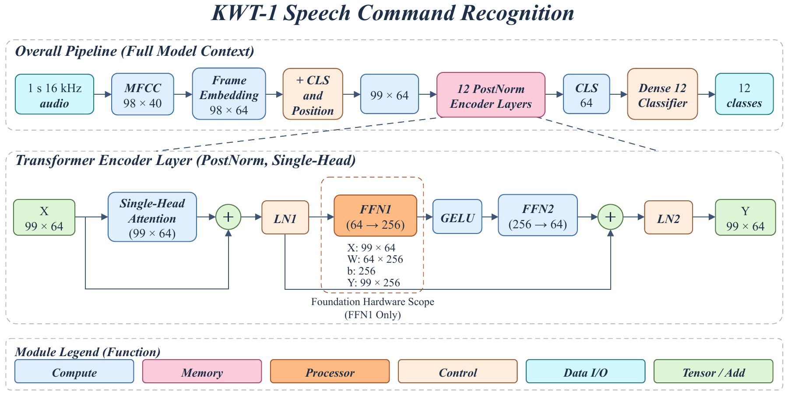
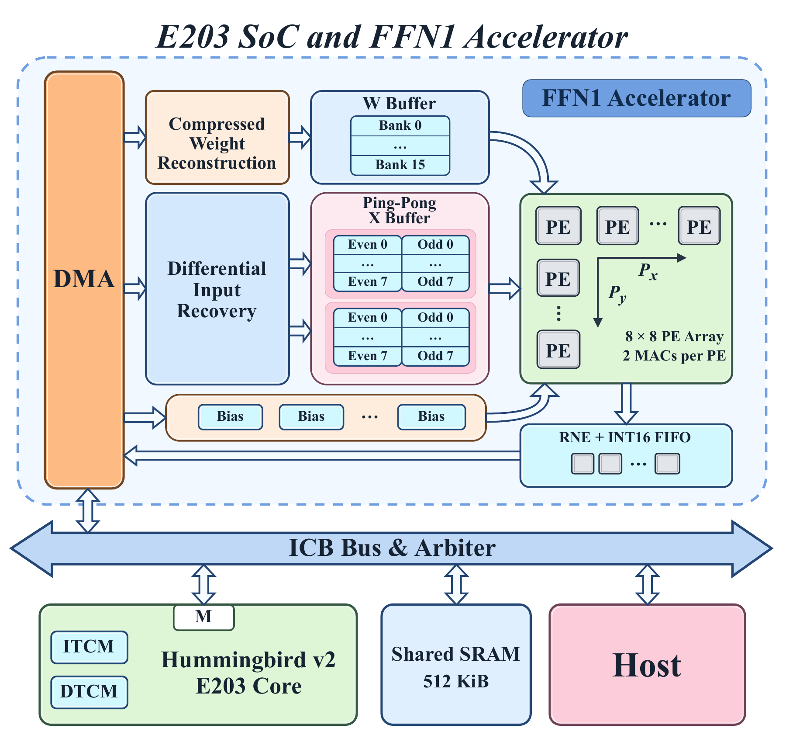
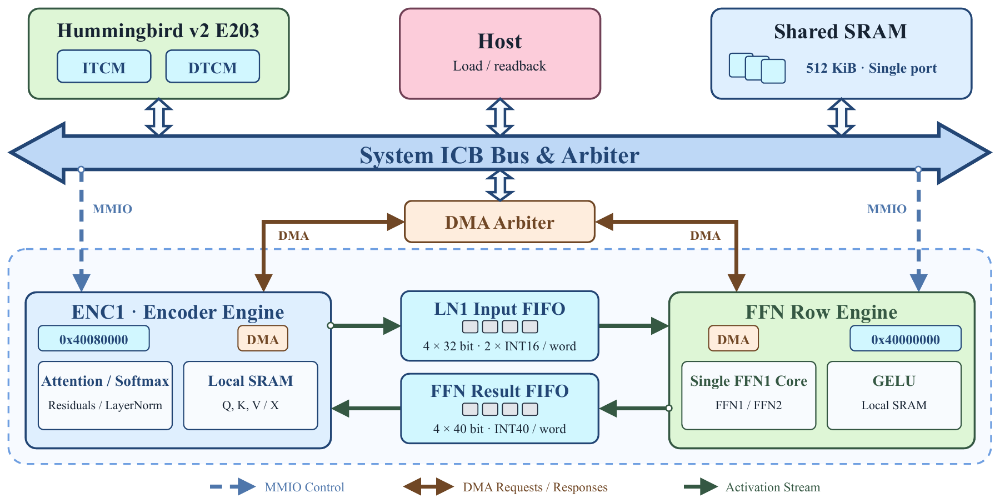

# KWT-1 关键词识别加速器

基于 E203 蜂鸟 SoC 的本科生组芯片设计赛题作品，面向端侧离线语音关键词识别。基础任务实现 KWT-1 第一前馈线性层（FFN1）的定点计算、DMA 与 SoC 集成。拓展任务实现完整 FFN、单头注意力及 12 层 PostNorm 编码器，并在 Z100 FPGA 上完成从 WAV 输入到分类结果的系统验证。

[设计报告 PDF](https://github.com/hhaxi/keyword_transfomer_accelerator/blob/26f715dc25a873ccb3f865f132093745b9ce3939/report/kwt-design-report.pdf) · [结果与证据](docs/results/README.md) · [复现指南](docs/reproduce.md) · [文档索引](docs/README.md)

1 秒音频经 MFCC 和嵌入形成 98 帧特征，加入 `[CLS]` 后得到 `99 × 64` 的编码器输入。软件执行预处理、嵌入与分类头。硬件编码器执行注意力、完整 FFN、残差相加与两次 LayerNorm，E203 负责配置与逐层调度。

## 基础任务 · FFN1

FFN1 对 `99 × 64` 输入和 `64 × 256` 权重执行矩阵乘加与偏置处理。Q128 `reference_sleep` 配置采用 **8 × 8 输出驻留阵列、每个 PE 双路乘加，共 128 路 MAC**。行列广播复用操作数，权重常驻、输入双缓冲和无损压缩降低搬运开销。DMA 独立搬运操作数及结果，E203 通过 IRQ/WFI 等待任务完成。输入和权重为 INT16，内部以 INT40 累加，结果经就近取偶舍入与饱和后以 INT16 写回。

  

## 拓展任务 · 12 层编码器

紧凑单路版复用一套 ENC1 和 FFN 行引擎。ENC1 负责单头注意力、残差和 LayerNorm，FFN 行引擎执行 `64 → 256 → 64` 两级线性变换及 GELU。LN1 以 32 位 FIFO 送入 FFN，FFN 结果以 40 位 FIFO 回传。中间层的 LN2 结果驻留片内，Host 可在当前层尾段预装下一层参数，末层结果写回共享 SRAM。

## 报告结果

| 配置 | 任务周期与吞吐 | 面积、功耗与板测 |
| --- | --- | --- |
| 基础 FFN1 · Q128 IRQ/WFI | 12 组层任务平均 **32,006.83 拍**，150 MHz 折算 **4,686.50 任务/秒** | 新增综合面积 **0.505555 mm²**。第 4 层任务整机功耗 **37.346 mW**、能量 **7.6038 µJ** |
| 拓展 ASIC · 紧凑单路 | 一条输入执行 12 层共 **4,206,337 拍**，150 MHz 折算 **28.042 ms、35.660 任务/秒** | 新增综合面积 **1.489217 mm²**。整机功耗 **100.643 mW**、能量 **2.822 mJ/任务** |
| Z100 FPGA · 55.56 MHz 紧凑单路 | 板上时延中位数 **75.62 ms**，复用 TCP 连接的端到端实测吞吐为 **12.66 条输入/秒** | 逐条新建 TCP 连接时，端到端中位数 **80.26 ms**、P95 **82.09 ms**、最大 **82.80 ms** |

ASIC 面积采用 DC 综合单元面积，新增范围含加速器、内部 SRAM、DMA 和接口，E203 与共享 SRAM 单独统计。整机功耗来自 RTL-SAIF 活动估算。两项综合的 Setup WNS 均为 0.00 ns，SS Hold WNS 均为 −0.17 ns。[测量范围与原始记录](docs/results/README.md)

- **RTL** · 紧凑单路版通过 12 条输入 × 12 层回归，最终 **76,032 个整数输出**逐位一致。
- **软件** · Speech Commands V2 的 4,445 条本地验证记录中，浮点和定点均为 **4,351/4,445（97.8853%）**，逐条预测一致，最大逐层聚合 NRMSE 为 **0.171308%**。[验证记录](docs/validation/encoder-validation-expanded.md)
- **上板** · 12 条冻结向量的 76,032 个输出逐位一致。120 条分类样本均与定点软件预测一致，**119/120（99.17%）**命中真实标签。[分类原始数据](docs/evidence/report/z100-compact1-board-validation.json)

## 源码与复现入口

| 工程 | 源码与命令 |
| --- | --- |
| [Q128 FFN1](projects/ffn1/README.md) | `projects/ffn1/` 包含 IRQ/WFI 定版封包、冻结向量、12 组参数回归和 DC/VCS 入口 |
| [紧凑单路编码器](projects/encoder/README.md) | `projects/encoder/` 包含 E203 SoC、定点模型、固件和 12 层 RTL 回归 |
| [Z100 55.56 MHz 上板](projects/encoder/integration/z100/README.md) | 编码器工程内的 Vivado、ARM 固件、烧录和 TCP 实测入口 |

[结果与证据](docs/results/README.md)记录正式配置的综合和板测口径。紧凑单路 ASIC 服务器综合包还包含 E203 ICB LINK-3 位宽适配。[综合配置](docs/evidence/report/encoder-compact1-ppa.txt)

## 仓库结构

- `projects/ffn1/` · Q128 IRQ/WFI 正式工程。
- `projects/encoder/` · 紧凑单路编码器与 Z100 板卡集成。
- `docs/` · 报告结果、原始证据、框架图与[历史工程归档](docs/archive.md)。

上游模型、E203、Speech Commands V2 数据和许可证见 [NOTICE](NOTICE.md) 与[资源锁定清单](projects/encoder/assets/resources.lock.json)。
