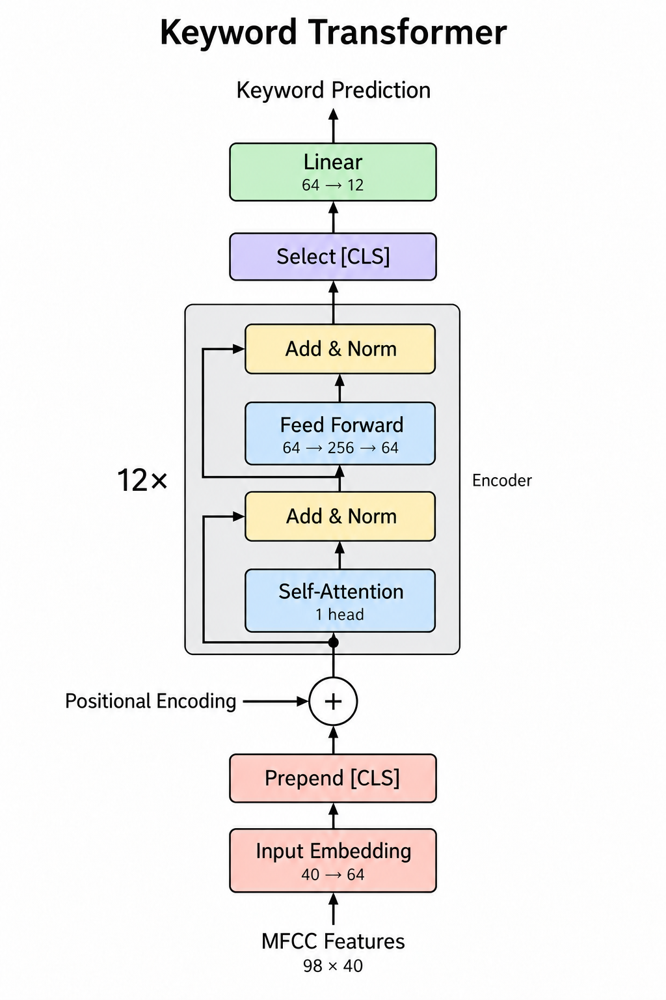
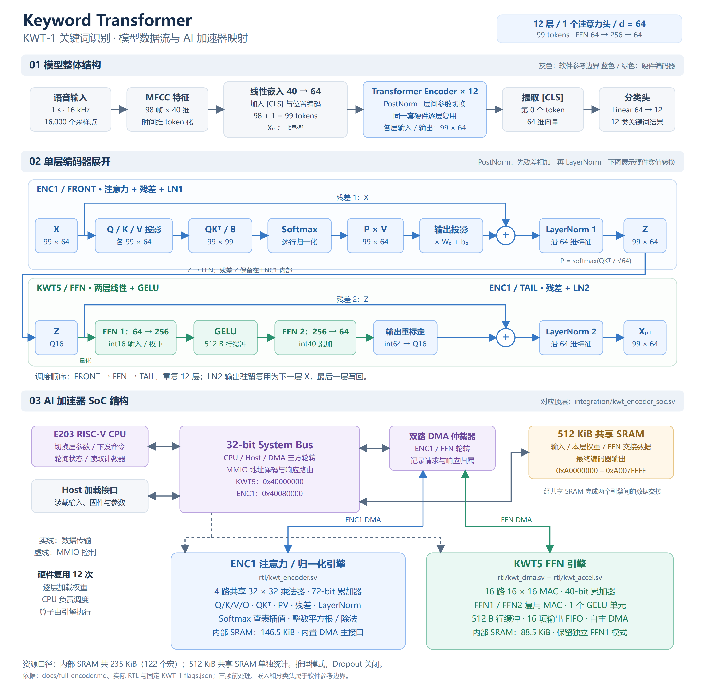

# KWT-1 关键词识别加速器

| 工程 | 入口 |
| --- | --- |
| 完整编码器及独立 FFN 模式 | 根目录的 `encoder.ps1`、`design.ps1`，详见下文 |
| 本科 FFN1 独立工程 | [16 路 MAC、四项优化与 16 组合复现](undergrad_ffn1/README.md) |
| 本科 FFN1 候选方案 | [候选索引](undergrad_ffn1/candidates/README.md) · [Q128 IRQ/WFI 实测 PPA](undergrad_ffn1/candidates/q128_reference_sleep/reports/RESULTS.md) |

面向本科生组芯片设计赛题，基于 **E203 蜂鸟 SoC** 实现第一线性层、完整 FFN 和 **12 层 PostNorm Transformer 编码器**。工程包含可综合 RTL、冻结整数模型、参数转换、RISC-V 固件、SoC 集成及自动化验证。

**当前版本：编码器第五版 + FFN 第十版。** 基于 `b716312` 增加可切换的 LN1→FFN 输入直传和权重预装载，保持 16 路 FFN MAC 与冻结整数运算。单层同条件周期从 **1,250,753 降至 1,231,235**，减少 **19,518 拍（1.5605%）**，输入交接每层减少 **6,336 个32位 DMA 字**。两种独立模式仍为 **167,134 / 305,708 周期**。十二层为 **14,315,119 周期**，减少 **1.6099%**；加速器 DMA 流量减少 **15.5294%**。

[设计与接口](docs/full-encoder.md) · [输入直传与最新性能](docs/input-stream.md) · [验证记录](docs/evidence/input-stream-validation.json) · [赛题指南](docs/芯片设计赛题指南.pdf) · [第三方来源](NOTICE.md)

**最新主机装载优化（基于 `d9dc461`）：**精确拆分输入、参数、控制写和完成邮箱轮询后，增加可关闭的有界主机授权。固定 `DMA_BURST=8`，将 `HOST_BURST` 从0切到2，Linear / FFN 完整周期降至 **153,301 / 281,587（减少7.0920% / 6.5761%）**；十二层降至 **13,855,994（减少2.8564%）**。新旧配置的两种独立模式各12项、**12条输入×十二层**均逐位通过，公平性、背压和取消恢复通过。收益来自主机串行装载，编码器硬件运行周期未变；独立模式CPU最长等待可由8增至9拍。**生产默认仍为 `DMA_BURST=1, HOST_BURST=0`，保留下文基线性能**。详见 [主机装载分析与完整对照](docs/host-study.md) 和 [验证记录](docs/evidence/host-study-validation.json)。未进行PPA测量。

前一轮 [总线归因与对照](docs/bus-study.md) 基于 `c0724ce`：可选 `DMA_BURST=8` 使 Linear / FFN 为 **165,003 / 301,408 拍**，十二层为 **14,263,416 拍**；该配置是本轮主机优化的同条件对照。

前一轮 [QKV 周期研究](docs/qkv-study.md) 基于 `f7a3a47`：每层308,886拍中有效MAC为304,128拍，利用率98.46%；局部调度的理想整机收益上限不足0.40%，因此保留了原计算调度。

## 1. 实现范围

| 工作模式 | 计算内容 | 当前状态 |
| --- | --- | --- |
| 第一线性层独立模式 | `X[99,64] × W[64,256] + b[256]` | 保留本科必做功能，支持 12 层参数切换 |
| 完整 FFN 独立模式 | 第一线性层 → GELU → 第二线性层，维度 `64 → 256 → 64` | 整数结果一致，独立模式无性能回退 |
| 完整编码器 | 注意力 → 残差/LN1 → 完整 FFN → 残差/LN2，连续执行 12 层 | 已实现第 4—7 项拓展涉及的编码器功能及本地验证流程 |

固定模型配置为 **99 token、64 维特征、单头注意力、256 维 FFN 隐层、12 层编码器**。它不是可动态配置任意尺寸的通用 Transformer 加速器。

<p align="center">
  
</p>

上图展示完整模型结构；98 帧 MFCC 经嵌入并加入一个 `[CLS]` token 后，形成编码器的 99 token 输入。下图说明本工程的软件与硬件计算边界。

```text
软件：音频前处理 / MFCC / 嵌入
                 │
                 ▼ X [99,64]
       ┌─────────────────────────────────────────────┐
       │ Q/K/V → QKᵀ / 8 → 行 Softmax → PV → Wo + bo │
       │                  ↓                          │
       │            残差相加 → LN1                   │
       │                  ↓                          │
       │     FFN1 [64,256] → GELU → FFN2 [256,64]    │
       │                  ↓                          │
       │            残差相加 → LN2                   │
       └─────────────────────────────────────────────┘
                 │ 重复 12 层，跨层复用驻留结果
                 ▼
软件：class token 分类头
```

注意力、两次残差、两次 LayerNorm 和 FFN 算子均由硬件计算。E203 固件负责配置地址、启动、等待完成及读取状态；音频前处理、嵌入和最后分类头属于软件参考边界。当前已集成真实 E203 CPU 和共享总线，不只是孤立的计算核。

## 2. 输入直传基线性能与优化

本轮使用同一 RTL 可执行文件、同一固件与冻结向量，通过配置位选择 SRAM 交接或输入直传。SRAM 路径保留 `b716312` 的数据通路；新固件的控制调度与历史固件稍有不同，因此严格对照采用本轮两种模式，历史第四版数据单独保留。

| 工作负载 | SRAM 输入对照 | 输入直传 | 变化 |
| --- | ---: | ---: | --- |
| 单层完整任务（task 0） | 1,250,753 | **1,231,235** | 减少 **19,518 拍，1.5605%** |
| 十二层完整任务（task 0） | 14,549,345 | **14,315,119** | 减少 **234,226 拍，1.6099%** |
| 第一线性层独立任务 | 167,134 | **167,134** | 无回退 |
| 完整 FFN 独立任务 | 305,708 | **305,708** | 无回退 |

编码器计时包含初始输入加载、各层参数加载、CPU 调度与统计、硬件计算、最终写回确认及通知观察；不含固件初次装载和计时后的输出比较。

本版新增 **4×32位输入 FIFO**，保留已有 **4×40位输出 FIFO**。输入的最近偶数舍入、缩放、饱和，以及 FFN 后的原始残差相加和 LN2 顺序完全不变。权重提前加载到既有存储体，并避让编码器读装载阶段；首个8行块完整到达后开始 FFN。X SRAM 单端口在 L1 读周期阻止写入，L2 阶段及输出堵塞时继续接收后续输入，防止互相等待。

单层 DMA 从 **52,416 降至 46,080 个32位字**；十二层从 **489,600 降至 413,568 字**。正常单层输入 FIFO 满等待 **8,190 拍**、空等待 **1 拍**、最大占用 **4/4**。前段本身因背压变长，完整任务仍缩短；收益来自搬运与重叠，MAC 运算量没有减少。FFN 命令现在从预装载开始计时，与注意力及尾段重叠，三个命令周期不能直接相加。

原有16路 MAC、奇偶 k 部分和、输出合并、两笔在途 DMA、紧凑40位写回和输出 FIFO 均保留。第四版性能及尾段分析见 [FIFO 研究](docs/fifo-study.md)，更早的传输模式对照见 [传输报告](docs/frontend-transfer.md)。

## 3. 硬件组织与接口

| 模块 | 主要文件 | 职责 |
| --- | --- | --- |
| 编码器伴随引擎 | `rtl/kwt_encoder.sv` | 注意力、残差、LayerNorm、编码器 DMA 和周期计数 |
| FFN 引擎 | `rtl/kwt_accel.sv`、`rtl/kwt_dma.sv` | 两种独立模式、矩阵计算、GELU、输入/权重加载与结果写回 |
| 输入/结果 FIFO | `rtl/kwt_result_fifo.sv` | 参数化位宽，4深度；32位输入与40位输出，背压与取消清空 |
| 数学与存储模块 | `rtl/kwt_exp_negative.sv`、`kwt_udiv64.sv`、`kwt_isqrt64.sv`、`kwt_vecmem32.sv` | 指数近似、整数除法/平方根及同步 SRAM 接口 |
| 扩展总线 | `integration/kwt_extended_system_bus.sv`、`kwt_dma_arbiter.sv` | CPU、主机与共享 SRAM 连接，两个 DMA 的公平仲裁 |
| 完整 SoC 顶层 | `integration/kwt_encoder_soc.sv` | E203 CPU 与两个硬件引擎集成 |
| RISC-V 驱动 | `firmware/kwt_encoder_driver.c`、`kwt_driver.c` | 按模型顺序启动编码器与 FFN |

资源配置保持 **16 路 FFN MAC、1 个 GELU、4 路编码器共享 32 位乘法通路**；指数插值等另有辅助算术，不能将这些主通路数当作整个 SoC 的全部乘法器数。

完整加速器内部 SRAM 的 RTL 组织仍为 **235 KiB / 240,640 B / 122 个 16 位宏**，其中原 FFN 占 88.5 KiB。输入和结果 FIFO 负载合计为 **36 B 寄存器**，另有打包与控制寄存器；本轮未重新测量综合面积。System Bus 的 **512 KiB 共享 SRAM** 与 E203 自有存储边界单独统计。Q/K/V/O 复用投影权重缓存，LN2 结果可驻留供下一层使用。

| 寄存器窗口 | 标识 | 操作 |
| --- | --- | --- |
| `0x40000000` | `KWT5` | `0x38`：0=第一线性层，1=完整 FFN 64 位写回，2=完整 FFN 紧凑40位写回，3=结果 FIFO 直传，4=输入/结果 FIFO 直传及权重预装载 |
| `0x40080000` | `ENC1` | 操作寄存器 `0x38`：0=注意力至 LN1 并输出 FFN 输入，1=读取 FFN 结果并完成残差/LN2 |

ENC1 的细分计数位于偏移 `0x60—0x90`，配置 `0x34` 的 bit2/bit3 分别选择紧凑40位/FIFO，互斥。bit4 选择本版输入直传，须与 bit3 配合。KWT5 `0x94` 统计直传结果数、`0x98` 统计输入字数。接口与并发启动顺序见 [编码器接口文档](docs/full-encoder.md) 和 [直传协议](docs/frontend-transfer.md)；旧 FFN 协议见 [基础架构](docs/architecture.md)。

<p align="center">
  
</p>

上图为模型、单层编码器与 AI 加速器 SoC 的整体映射；可编辑版本为 `docs/figures/keyword-transformer-architecture.svg`，由 `scripts/draw_kwt_architecture.py` 生成。

## 4. 验证结果与适用边界

| 验证项目 | 已完成的本地结果 |
| --- | --- |
| 编码器 RTL 整机 | **12 条输入 × 12 层**，每条最终 6,336 个整数输出逐位一致 |
| 编码器通用网表整机 | 第二版历史结果：1 条输入 × 12 层通过；本轮新版尚未重新综合及网表回归 |
| 两种独立 FFN 模式 | 本轮 RTL 各执行 12 个任务，结果正确，完整 FFN 无性能回退 |
| 中间矩阵 | 本轮单层注意力/残差/LN 逐位核对，整机逐层核对 LN1 打包输入和 FFN 输出；历史12层完整中间矩阵证据保留 |
| 数学与边界 | 除法 1,029 例、平方根 1,031 例、指数近似 34,855 例；覆盖常量输入、零方差等边界 |
| 总线与异常 | 本轮覆盖单端口仲裁、慢输入、权重就绪、两笔在途排空、满 FIFO、末字背压取消、双端取消及重启；Verilator/Icarus 通过 |
| 软件数值参考 | 完整 validation 索引 **4,445 条**，浮点与整数模型均正确 **4,351/4,445（97.8853%）**；预测全部一致，实际饱和 **0**；最大逐层聚合 NRMSE **0.171308%** |

扩展数值验证包含 **4,074 个不同音频文件 + 371 个重复静音条目**，与 RTL 整机的 12 条输入是不同验证范围。逐层误差、最差样本、分类差异、各阶段饱和及完整明细见 [扩展验证报告](docs/encoder-validation-expanded.md)。原 120 条样本复测仍为 119/120，12 层聚合误差与历史报告完全一致。模型与整数格式保持冻结，不使用测试集调节尺度。

本轮逐层观测、输入指纹和日志校验值见 [input-stream-validation.json](docs/evidence/input-stream-validation.json)；[fifo-study-validation.json](docs/evidence/fifo-study-validation.json) 保留第四版证据；[frontend-transfer-validation.json](docs/evidence/frontend-transfer-validation.json) 保留第三版证据，[encoder-validation.json](docs/evidence/encoder-validation.json) 保留第二版历史网表证据。本轮未重跑 4,445 条软件评估，冻结数学文件未变。新版综合/网表以及正式 **150 MHz、≤2.25 mm²、功耗、能耗及官方 600 条样本评测**仍待完成。

## 5. 首次配置

当前复现脚本面向 **Windows x64 + PowerShell + WSL Ubuntu**。先安装 Git、uv，并准备以下工具：

| 工具 | 用途 / 配置方式 |
| --- | --- |
| Verilator（WSL）、Icarus Verilog（Windows） | RTL/网表仿真、四态检查及 lint；按配置模板填写对应路径 |
| Yosys | WSL 中的通用综合与结构检查 |
| ModelSim、OpenSTA | 当前完整环境自检会调用；ModelSim 需要可用许可证，OpenSTA 自检仅检查工具启动 |
| Python 模型环境、Nuclei GCC、GNU Make | 由 `setup.ps1` 安装到项目内；GCC 用于 RV32 固件编译 |
| GTKWave | 可选，用于查看波形 |

`setup.ps1` 不负责安装 WSL、外部 EDA 软件或商业许可证。模型运行使用 CPU，无需 CUDA。

```powershell
git clone https://github.com/hhaxi/keyword_transfomer_accelerator.git
cd keyword_transfomer_accelerator

# 仅在首次配置时复制；已有配置应直接编辑。
Copy-Item environment/local-tools.example.json environment/local-tools.json
notepad environment/local-tools.json

# 下载固定版本的模型、权重、Speech Commands V2、E203 和 SDK。
uv run --no-project --python 3.13 scripts/download_competition_assets.py

# 创建模型环境、安装项目私有工具链并执行环境自检。
.\setup.ps1
```

模型环境使用 **Python 3.8.20、TensorFlow 2.4.0、NumPy 1.19.5**；下载辅助脚本使用独立的 Python 3.13。上游原环境为 TensorFlow 2.4.0rc1，本机采用 2.4.0 开发替代版，与官方浮点运行环境的等价性仍需确认。完整依赖见 [依赖锁文件](environment/requirements-model.lock.txt)。

资源版本、来源和哈希见 [resources.lock.json](assets/resources.lock.json)。模型固定使用 `best_weights`，FFN 隐层维度以该 checkpoint 的 `flags.json` 为准。下载和安装期间建议预留至少 20 GB 空间，长时间仿真及波形可能需要更多空间。下载脚本会重新解压所选第三方源码，自研代码应保存在项目的 `rtl/` 等独立目录。

## 6. 运行与复现

所有命令均在仓库根目录执行。首次生成完整验证证据时，按以下顺序运行：

```powershell
. .\env.ps1

# 生成基础模型/FFN 向量，并完成原两种模式的验证。
.\design.ps1 all

# 生成编码器向量，执行功能、兼容性、整机、网表、性能对比及打包。
.\encoder.ps1 all
```

编码器默认样本选择依赖基础流程生成的 `output/vectors/` 和 `output/calibration/` 记录；兼容回归也使用原 FFN 向量。新克隆工程应先完成基础流程。已有完整环境和向量时，可按需执行：

| 命令 | 内容 |
| --- | --- |
| `.\encoder.ps1 input-single` | 单层同固件 SRAM/直传对照及逐层数据核对 |
| `.\encoder.ps1 input-protocol` | 输入分块、单端口、背压、双端取消、末字取消及四态恢复 |
| `.\encoder.ps1 input-full` | 单层收益及协议门槛通过后，1条 SRAM 对照和12条直传输入的十二层回归 |
| `.\encoder.ps1 component` | 12 层中间矩阵、连续 DMA 和常量输入检查 |
| `.\encoder.ps1 transfer` | 40 位打包、FIFO、真实 FFN DMA、12 层中间值和四态传输检查 |
| `.\encoder.ps1 fourstate` | Icarus 四态数学与组件检查 |
| `.\encoder.ps1 faults` | DMA/寄存器异常、中止恢复与仲裁检查 |
| `.\encoder.ps1 lint` | 扩展总线和加速器严格 lint |
| `.\encoder.ps1 compat` | 两种独立 FFN 模式的 RTL 兼容与性能回归 |
| `.\encoder.ps1 soc` | 12 条输入的真实 E203 编码器整机 RTL 回归 |
| `.\encoder.ps1 transfer-profile` | 同硬件、同固件三种结果传输方式的整机对比 |
| `.\encoder.ps1 fifo-baseline` / `fifo-profile` | 旧合并调度1条输入 / 新调度12条输入，记录逐层 FIFO 与尾段分解 |
| `.\encoder.ps1 profile` | 同配置跨层驻留 A/B 及内存访问统计 |
| `.\encoder.ps1 synth` | 生成保留 SRAM 边界的通用网表 |
| `.\encoder.ps1 netlist` | 1 条输入、12 层网表整机回归，需先综合 |
| `.\encoder.ps1 compat-netlist` | 两种独立 FFN 模式的网表回归，需先综合 |
| `.\encoder.ps1 collect` / `package` | 校验证据并生成报告 / 本地交付包 |

整机回归较长，可将 12 条输入分为四个独立仿真进程；并行只缩短宿主机运行时间，不改变硬件周期：

```powershell
.venv-model\Scripts\python.exe scripts/run_encoder.py soc --tasks 12 --jobs 4
```

默认 SoC 使用输出 FIFO 和 SRAM 输入；`--input-stream 1` 启用输入直传，`--layers 1` 用于单层对照。`--transport 0/1/2` 可选择旧64位/紧凑40位/FIFO40。`tools.ps1 all` 是环境自检入口，不能替代设计验证。当前输入直传复现见 [专门流程](docs/input-stream.md)。`all` 还会执行耗时的综合与网表流程，本轮未执行这部分。

冻结格式的完整 validation 数值评估与报告导出（使用新的输出目录）：

```powershell
.venv-model\Scripts\python.exe scripts/evaluate_encoder.py --sample-list docs/evidence/encoder-validation-expanded.samples.json --output output/encoder-validation-replay
python scripts/report_encoder_evaluation.py --evaluation output/encoder-validation-replay --publish output/encoder-validation-replay-summary
```

省略 `--sample-list` 可按上游规则重新选择完整 validation 索引；使用仓库清单可固定 unknown 抽样和样本顺序。评估保存每条样本的逐层误差、分类 logits 与差异、各阶段实际饱和、Softmax 固定截断及文件校验值。完整说明与结果见 [扩展数值验证](docs/encoder-validation-expanded.md)。该流程不修改格式、权重或硬件验证向量。

官方样本清单到位后的编码器导出入口：

```powershell
.venv-model\Scripts\python.exe scripts/export_encoder.py --split testing --sample-list official-samples.json --output output/encoder-official
```

清单为数据集相对音频路径组成的 JSON 数组，静音项为 `"silence"`。此命令生成参考与硬件向量；官方硬件评测还需对接对应平台的加载、运行和读取流程。自定义第一线性层数据转换见 [架构文档](docs/architecture.md)。

## 7. 工程目录与交付

```text
rtl/                        自研计算核、DMA、数学模块及 SRAM 接口
integration/                E203 集成、共享 SRAM、System Bus 与 DMA 仲裁
firmware/                   RISC-V 启动代码、驱动和整机测试程序
model/                      冻结整数格式、参考模型及样本选择
scripts/                    资源获取、模型转换、构建、验证、打包与架构图绘制
tests/                     RTL 测试平台、数值检查与性能观察器
constraints/                目标时钟和顶层接口约束
docs/                       设计、验收口径与当前各轮性能研究
docs/evidence/              机器可读验证/性能证据（JSON 与样本清单）
docs/history/               被后续版本取代的历史报告与基线快照
docs/figures/               文档插图（含可编辑的架构图）
undergrad_ffn1/              本科 FFN1 独立工程、冻结基线和候选方案
environment/               工具配置模板、依赖锁定及环境自检
assets/resources.lock.json  上游资源版本与校验值
encoder.ps1                 完整编码器验证入口
design.ps1                 第一线性层与完整 FFN 验证入口
setup.ps1 / env.ps1          首次安装 / 当前终端环境
```

本地产物位置：

| 路径 | 内容 |
| --- | --- |
| `output/design/` | 仿真、lint、综合日志及构建目录；`build_*/` 为可清理的编译缓存 |
| `output/encoder-design/` | 编码器固件、通用网表与综合记录 |
| `output/encoder-vectors/`、`output/encoder-calibration/` | 编码器验证/训练检查向量与数值报告 |
| `output/baseline-v2/`—`output/baseline-v8/`、`output/baseline-encoder-v1/` | 历史版本输出快照（仅本地保留） |
| `docs/input-stream.md`、`docs/evidence/input-stream-validation.json` | 最新前端性能报告与机器可读证据 |
| `docs/fifo-study.md`、`docs/evidence/fifo-study-validation.json` | 第四版 FIFO 分析与历史证据 |
| `deliverables/undergraduate-encoder-frontend-v5.zip` | 本轮前端交付包，排除旧版网表 |
| `deliverables/encoder-submission-sha256.txt` | 交付包 SHA-256 |

文档目录的完整索引见 [docs/README.md](docs/README.md)。

当前 `collect` 检查 FIFO A/B 同固件同向量、12 条候选 SoC 覆盖、尾段/FIFO计数守恒、独立模式性能及冻结数学文件。它不替代新版网表验证。`package` 打包源码、参数、向量、已检查日志、输入指纹及固件，排除历史网表并校验归档内容。新增工程文件应先纳入 Git 暂存区，打包仅采集已跟踪/已暂存的源码文件。

第三方源码、模型权重、音频、工具、Python 环境、`output/` 与 `deliverables/` 均不随 Git 分发。新机器需要执行下载和复现流程，本机已有交付包不等于远端仓库中保存了这些大文件。

## 8. 保留基线与进一步阅读

| 基线 | 提交 | 说明 |
| --- | --- | --- |
| 第四版本科必做 | `d501f0d` | 保留第一线性层必做基线 |
| 第八版完整 FFN | `3461cf7` | 当前两种独立模式的功能与性能对照 |
| 第一版完整编码器 | `ccc7641` | 15,535,024 周期的编码器优化对照 |
| 第二版完整编码器 | `08b1969` | 组间调度、编码器连续 DMA 与细分计数；历史基线 |
| 第三版编码器 / 第九版 FFN | `59487c7` | 16 路独立线性层、40 位 FIFO；第四版 FIFO 研究基线 |
| 第四版编码器 / 第十版 FFN | `b716312` | 输出合并调度；本轮输入直传基线 |

本机分别保留 `deliverables/undergraduate-v4-baseline.zip`、`full-ffn-v8-baseline.zip` 和 `encoder-v1-baseline.zip` 等历史归档。第五至第七版 FFN 的过程记录仍保留在 Git 历史和对应文档中。

本轮基线的源码、验证包和固件保存在本地 `deliverables/b716312-baseline/`，哈希收录在最新验证报告。

此前另存 `encoder-v3-59487c7-source.zip` 和 `encoder-v3-59487c7-baseline.zip`，包含第三版源码、向量、日志与性能证据，校验值见 [冻结清单](docs/evidence/fifo-study-baseline.json)。

- [完整编码器设计](docs/full-encoder.md)：执行顺序、数值契约、寄存器和内存布局。
- [最新输入直传](docs/input-stream.md)：预装载、分块、单端口仲裁、背压、取消恢复与同条件对照。
- [第四版 FIFO 分析](docs/fifo-study.md)：供需判断、尾段分解及单项 RTL 对照。
- [第三版前端性能](docs/frontend-transfer.md)：16 路独立线性层、连续装载、紧凑打包及 FIFO 对比。
- [第八版 FFN 调度](docs/ffn-group-scheduling.md)：两种独立模式的当前基线。
- [完整 FFN 基础设计](docs/full-ffn.md)：双线性层与 GELU。
- [第四版必做性能](docs/parallel-packed-performance.md)：紧凑打包与必做基线。
- [赛题范围记录](environment/project-context.json)：已确认的本科组范围、参考平台与约束。

历史版本报告仅作追溯，归档在 `docs/history/`：[第二版编码器性能](docs/history/encoder-performance.md)、[第二版前端性能](docs/history/frontend-performance.md)、[第三版 DMA 性能](docs/history/dma-performance.md)、[第六版完整 FFN 性能](docs/history/full-ffn-performance.md)、[第七版 FFN 重叠性能](docs/history/ffn-overlap-performance.md)；对应基线 JSON 与 `performance-baseline*` 快照同目录保存。文档分层与全部证据文件索引见 [docs/README.md](docs/README.md)。

## 9. 清理与来源

清理前先预览：

```powershell
.\scripts\clean-project.ps1 -WhatIf
```

确认后去掉 `-WhatIf` 执行。脚本只删除可再生内容：`output/design/build_*/` 编译缓存、`output/baseline-v1/` 旧活动波形归档、各候选目录的 `study/` 与 `tmp/` 工作区，以及 `__pycache__`、下载缓存和临时目录。SHA-256 清单引用的 `output/` 证据、`assets/`、`.tools/`、`.venv-model/` 与 `deliverables/` 均保留。清理后需重新生成对应输出才能再次汇总或打包。

官方 SoC 参考为 [riscv-mcu/e203_hbirdv2](https://github.com/riscv-mcu/e203_hbirdv2)，模型来自 [ARM-software/keyword-transformer](https://github.com/ARM-software/keyword-transformer)，数据集为 Speech Commands V2。固定提交、下载地址和校验值均记录在资源清单中；上游许可文件随下载内容保留。自研与第三方边界见 [NOTICE.md](NOTICE.md)。
