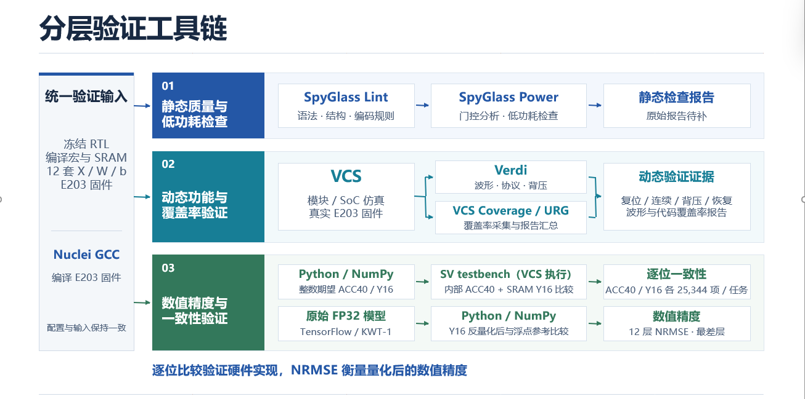
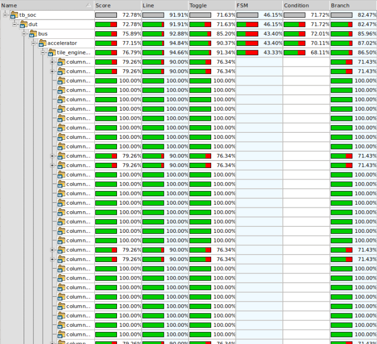
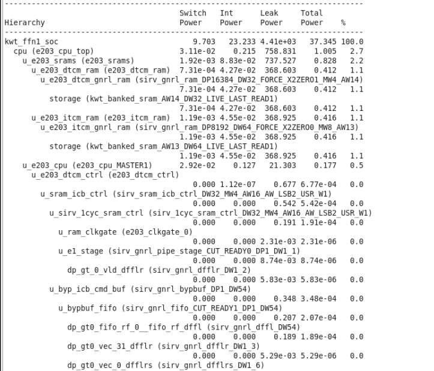
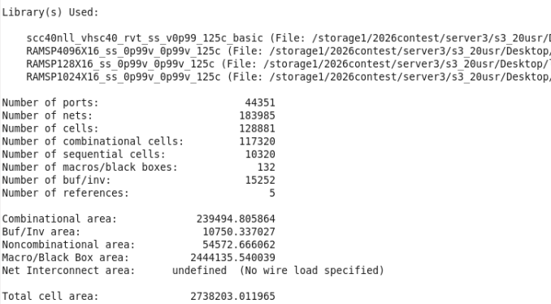
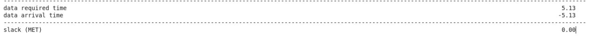
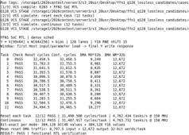

别人做好了一版ppt，在这个基础上改动：
第四页的流程图有点丑/最下面那个小字可以去掉
第五页下面那个黄色的块有点ai味儿，可以去掉。第四点下方的小字格式不太好
第六页左边架构图改成动图
第10页右边两个图块有点空虚
第十一页下面的黄色框有点ai味
第12页那个roofline模型不太好看，能不能重新画一下或者用其他方式表示下
第15页能否用这张图的组织方式，上面的流程图也比较奇怪

第17页左半部分有空着部分，调整结构；右侧那个选层说明不要
第18页右边那个非线性算子定点实现有点空，表达式用公式搞
第19页下面那个表述有点ai，换个说法

补充材料

