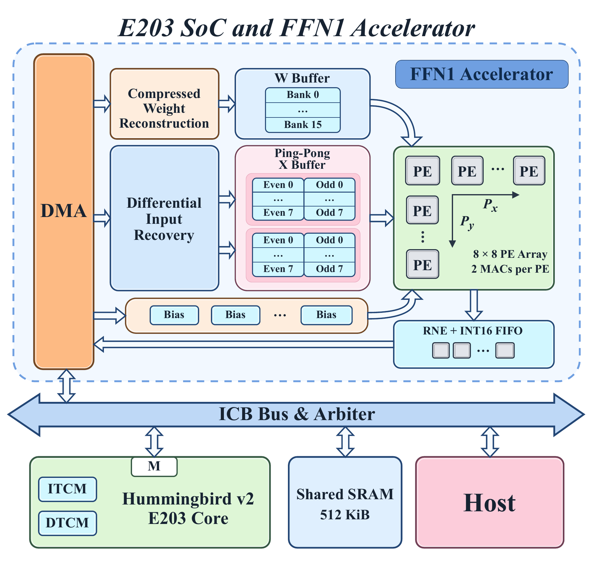
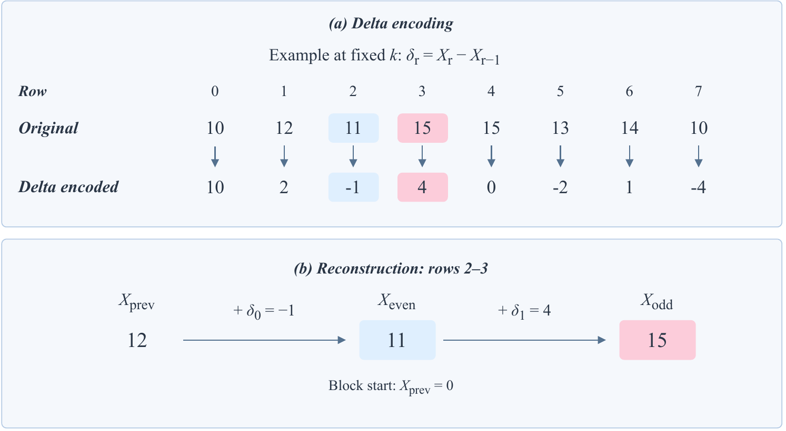
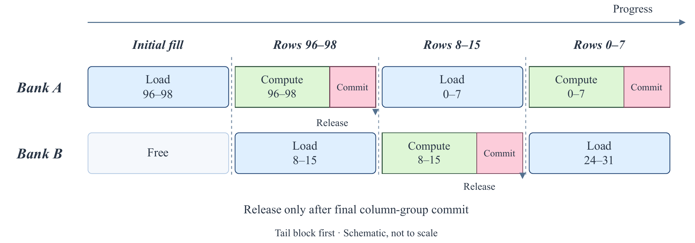
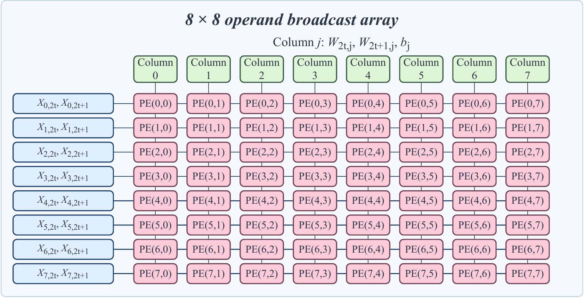
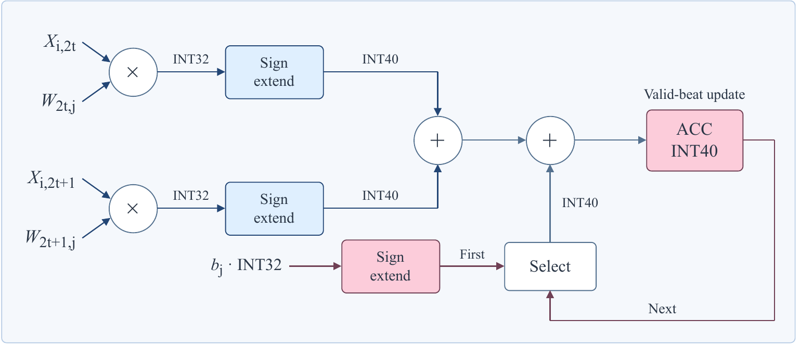

# 本科组竞赛答辩 PPT 逐页文案

**18 页主讲，7 分 45 秒，留 15 秒机动。** “上屏文案”可以直接复制到 PPT。“配图占位”“制作说明”和“讲稿”分别用于制图、核对数据和演讲者备注。所有 **【待补】** 都有对应的材料清单。

**本稿按 Q128 `dense_sched` 填入可核对的本地结果。** 如最终提交的是其他版本，按提交配置更新结构图、数值格式、计数和报告。Transformer 扩展使用父工程的数据，FPGA 单列移植配置。150 MHz 是 ASIC 综合目标和本地吞吐折算频率，最终时序结论见提交版 DC 报告。计分指标“单任务功耗”在 PPT 上统一写为**单任务能耗（µJ/task）**。

## 01｜封面 · 15 秒

**上屏文案**

> 面向 E203 SoC 的 KWT-1 前馈线性加速器  
> 本科组 · 芯片设计赛道  
> 【待补：队名、成员、学校、最终提交版本】

**配图占位**　右侧留一张简洁的 SoC 轮廓图，高亮 FFN1。作用是让评委知道项目交付的是一套接入 E203 的硬件系统。

**制作说明**　封面只保留标题、组别和队伍信息。硬件工作范围下一页展开。

**讲稿**　“各位评委好，我们是【队名】。本项目实现了 KWT-1 的第一前馈线性层，并针对 E203 系统的共享存储带宽优化了计算与搬运。”

## 02｜赛题背景与本科组任务 · 25 秒

**上屏文案**

- 应用：端侧离线语音指令识别
- 本科必做：64 项点积与数值处理 / FFN1 / E203 SoC 集成与综合
- 单任务：`X[99×64] × W[64×256] + bias → Y[99×256]`
- 验收：支持 12 套层参数 · NRMSE ≤ 3% · 150 MHz · 新增面积 ≤ 2.25 mm²

**配图占位**　左侧画“音频特征 → KWT-1 编码器 → 分类头”，在编码器内部只高亮 FFN1，外围以灰色显示。作用是交代任务的上下游和本科必做边界。

**制作说明**　12 套参数对应 12 次单层任务。正式精度评估在统一样本上按层汇总 NRMSE，再取最差层。第 16 页单独讲完整 Transformer 扩展。

**讲稿**　“KWT-1 用于端侧语音指令识别。本科组要求把前馈网络的第一线性层实现为硬件，并在 E203 平台完成加载、计算、写回和综合。一次任务产生 25,344 个结果，硬件支持切换十二层各自的参数。”

## 03｜项目进展与核心指标 · 20 秒

**上屏文案**

左侧流程节点：`数值模型 / 参数转换` → `RTL / E203 联调`。从联调分两支：

- `DC 综合` → `时序、面积、活动功耗` / `Formality 等价检查`
- `FPGA 实现` → `板上功能与资源报告`

右侧六格数据卡：

| 指标 | 当前填法 |
|---|---|
| 吞吐量 | **4,762 tasks/s · 15.45 GOPS** |
| 工作频率 | **150 MHz 目标** · 【待补：提交版时序结果】 |
| 数值精度 | 【待补：提交版最差层 NRMSE】 |
| 新增面积 | 【待补：mm²】 |
| SoC 平均功耗 | 【待补：mW】 |
| 单任务能耗 | 【待补：µJ/task】 |

**页脚**　吞吐为本地 12 个逐次复位任务、按 150 MHz 折算。GOPS 按 1 MAC = 2 OP，整机计时。

**配图占位**　左 60% 放分支流程图，右 40% 放六项指标。用颜色标出“已有报告”和“待补报告”。作用是同时展示项目进展与本次答辩的证据范围。

**制作说明**　若已取得提交版正式报告，将数据卡和第 18 页一同更新。不能把别的候选的低功耗与这套配置的吞吐合填。

**讲稿**　“目前已完成数值模型、RTL 和 E203 整机联调。右侧先给出整机吞吐和评价维度。接下来重点说明阵列如何供数、总线瓶颈在哪里，以及这些数字怎么测出来。”

## 04｜四项设计与优化 · 20 秒

**上屏文案**

| 设计点             | 解决的问题        |
| --------------- | ------------ |
| 8×8 分块与本地分 bank | 并行供数与跨行、跨列复用 |
| W 无损解码、X 差分恢复   | 减少共享总线的输入字数  |
| X 双缓冲、DMA 调度    | 重叠搬运与计算，减少空拍 |
| 宽累加、舍入和双结果写回    | 控制误差与输出流量    |
|                 |              |

**配图占位**　用一条“装载 → 本地存储 → 计算 → 写回”的简图，四项优化分别贴在对应位置。作用是给评委一张后续内容的导航图。

**制作说明**　两个层次分开介绍：分块与位宽是基础架构，压缩、预取与写回调度是针对带宽的优化。具体收益放第 9–11 页。

**讲稿**　“我们把优化集中在供数、搬运和写回。先用分块复用本地操作数，再缩减共享总线要传的数据量，用双缓冲和 DMA 调度把这些节省转化为整机周期。”

## 05｜系统架构 · 25 秒

**上屏文案**

**任务控制与 32 位总线读写**

| 环节       | 说明                                     |
| -------- | -------------------------------------- |
| **启动任务** | E203 通过 MMIO 配置加速器。配置就绪后发出启动命令。        |
| **搬运数据** | Host 将输入和参数装入共享 SRAM。DMA 经共享总线取数并写回结果。 |
| **确认完成** | 最后一笔写响应返回后，DMA 报告完成，E203 收到中断。         |

**讲稿**　“E203 通过 MMIO 配置并启动加速器。Host 将输入和参数装入共享 SRAM，DMA 经底部这条 32 位共享总线读入数据，计算结果也从这里写回。最后一笔写响应返回后，DMA 报告完成，E203 收到中断。”

## 06｜计算前的数据准备 · 35 秒

**左栏｜无损压缩减少总线搬运量**

共享 SRAM 中的 X 用相邻行差分，W 按所需位宽编码。经 32 位总线传输后，片内解包并无损恢复为 INT16。W 整层预装，X 按行块装载。

**X/W 压缩使 DMA 读取量减少 21.8%**

每任务平均从 11,616 降到 9,081.5 个 32 位字。

**右栏｜X 双缓冲让装载与计算重叠**

单缓冲要等当前块用完才能覆盖。双缓冲让阵列和 DMA 各用一组。

阵列从 A 计算第 96–98 行时，DMA 同时把第 8–15 行装入 B。理想情况下，当前块计算与下一块装载完全重叠，这一段耗时由两者相加降为两者中较长的一段。

**讲稿**　“进阵列前，我们先解决两个问题。第一，共享总线每拍只能传一个 32 位字，所以权重按所需位宽传，输入按相邻行的差值传。看左图的恢复过程：用上一行的 12 加 −1 得到 11，再加 4 得到 15。进入片内后仍恢复为 INT16。第二，只有一组 X 缓冲时，当前块没用完就不能覆盖。我们让阵列读 A 的同时，DMA 把下一块装进 B，等 B 就绪再交换。压缩减少 DMA 需要读的总线字。双缓冲则让下一块装载与当前块计算重叠，理想情况下这一段只取两者中较长的时间。”

**备答｜报告表 3-9：定宽与变宽编码的十二层平均传输字数**

| 传输项 | 定宽（32 位字） | 压缩后（32 位字） | 减少比例 |
|---|---:|---:|---:|
| 输入 X 读取 | 3,168 | 2,419.5 | 23.63% |
| 权重 W 读取 | 8,192 | 6,406 | 21.80% |
| 偏置读取 | 256 | 256 | 0% |
| **DMA 读取合计** | **11,616** | **9,081.5** | **21.82%** |
| Y 写回 | 12,672 | 12,672 | 0% |

每任务平均少读 **2,534.5 个 32 位字**。这是 DMA 读取量的降幅。双缓冲减少的是暴露在计算外的等待时间，整机加速比例需要同条件周期对照。

## 07｜8×8 PE 阵列的广播与并行计算 · 30 秒

**左图｜阵列级：操作数沿行、列广播**

每行两个 X，横向供 8 个 PE 共用。每列两个 W，纵向供 8 个 PE 共用。

**右图｜单个 PE：每拍累加两个乘积**

一个 PE 负责一个输出。偶、奇 k 各做一次乘法，两个乘积相加后更新同一个 INT40 累加器。64 项点积经过 32 个有效计算拍完成。

**页底结论**　每拍从片内读 **16 个 X 和 16 个 W**，完成 **64 × 2 = 128 次乘法**。

**讲稿**　“先看左图。同一行的两个 X 横向送给八个 PE，同一列的两个 W 纵向送给八个 PE，所以同一个操作数能用八次。再放大其中一个 PE：偶、奇两个 k 同时乘，两个乘积一起加进本地累加器。这样每拍读十六个 X 和十六个 W，就能做一百二十八次乘法；一个输出的六十四项点积用三十二个有效计算拍完成。”

**备答**　每个 PE 首拍以偏置作为累加初值，后续拍使用本地部分和。32 拍不含预取和提交等待。99 行输入分成 12 个满块和 1 个有 3 行的尾块，尾块只写回有效行。

## 08｜数值格式与精度验证 · 35 秒

**左侧｜点积全过程保留累加精度**

| 环节 | 数值格式与处理 |
|---|---|
| 输入与偏置 | X/W INT16，偏置 INT32 |
| PE 累加 | INT40 累加，64 项乘积累加过程中不截断 |
| 结果写回 | INT16 输出，累加完成后再舍入、饱和 |

**右侧｜与浮点参考对比**

**0.022% 最差层汇总 NRMSE**（本地基线，12 层）。赛题上限 **3%**。

**讲稿**　“上一页讲阵列怎么算，这一页看结果写回之后还准不准。输入和权重用 INT16，偏置用 INT32。六十四项点积在 INT40 里完整累加，结束后才舍入并饱和成 INT16。以本地基线和浮点结果比较，十二层中误差最大的一层，汇总 NRMSE 约为 0.022%，赛题上限是 3%。”

**备答｜精度口径**

报告的 0.022189% 来自 Q128 reference_sleep 的本地验证，共 9,982 条样本、119,784 次 FFN1。每层对全部样本和输出元素计算汇总 NRMSE，再取 12 层最大值。正式提交配置的分数须按同一口径单独核对。

| 历史 X/W 位宽 | 历史最差层 NRMSE |
|---|---:|
| INT8 / INT8 | 2.8547% |
| INT10 / INT8 | 1.0208% |
| INT16 / INT16 | 0.0131% |

历史扫参使用 600 条开发集样本，各方案使用各自尺度。这组数据用于解释位宽取舍，与本地基线 Y16 精度分别统计。

## 09｜周期剖析：装载、计算与写回 · 35 秒

**上屏文案**

| Q128 写回优先版，12 个复位任务平均 | 周期 |
|---|---:|
| Host 装载及启动前等待 | 9,029.5 |
| DMA LOAD | 6,842.5 |
| RUN：计算、预取与写回重叠 | 15,621.0 |
| 总计，含控制阶段 | **31,496.5** |

- RUN 内：`MAC + LAST` 状态 **12,908 拍**，等 X 约 **2,153 拍**
- 整任务有效载荷下界约 **30,267 拍**，实际约高 **4%**

**配图占位**　上方画三段堆叠时间轴。下方放 RUN 放大框，用两条并行泳道画“PE 计算 / 等 X”和“DMA 预取 / 写 Y”。作用是区分任务阶段与阶段内重叠活动。

**制作说明**　第一行对应 DMA 的 IDLE 阶段，包含 Host 与启动调度。三个大阶段按计数显示，另有少量状态开销及首末边沿取样差异。RUN 内的核心状态、总线访问量有重叠，不能再加进总周期。下界按 `2×(X+W+bias 输入字数)+Y 字数`，包含压缩头和对齐。阵列有数据时推进速度由 MAC 决定，等 X 和输出积压时受搬运约束。

**讲稿**　“启动前是装载主导。进入 RUN 后，有数据时阵列执行乘加，等待下一 X 块时则由搬运限制。整任务接近有效载荷的总线下界，所以重点是减少字数和空闲时隙。下一页用 DMA 调度对照验证这个判断。”

## 10｜DMA：两笔在途与运行阶段写回优先 · 30 秒

**上屏文案**

- **两笔顺序在途信用**，记录请求类型与响应目标
- **请求寄存、同拍接收与补发**，背压时保持请求稳定
- **RUN：就绪 Y 优先写回**，X 预取仍受缓冲占用保护
- 同条件：**31,570.5 → 31,496.5 拍**，平均少 **74 拍**

**配图占位**　左侧画“请求寄存 → 2 项响应标签 → 返回分流”，标出读响应进入解码或 X 缓冲。右侧用波形标“旧响应退役 / 新请求接收”发生在同拍。作用是区分 DMA credit 和共享端口吞吐。

**制作说明**　RTL 使用 `outstanding_count`、`response_head/tail`、`response_target[0:1]`。DMA 侧支持最多两笔已接收未完成事务的跟踪。当前互连只有一个响应槽，支持旧响应退役和新请求接收同拍发生，仍每拍最多一条 32 位命令。这里的两笔信用不是双端口、双发射或乱序。写回优先增加等 X，减少输出等待，总 RUN 平均缩短 74 拍。该对照保持数值格式、MAC 数和数据量一致。

**讲稿**　“DMA 用两笔顺序信用跟踪响应，在请求和响应能够衔接时减少空拍。在 RUN 中优先发已经就绪的 Y 写请求。实测等待 X 的时间增加，但输出队列腾得更快，整机平均节省七十四拍。”

## 11｜Y 写回：舍入、饱和与索引 · 25 秒

**上屏文案**

- **ACC40 ÷ 2¹⁵ → 最近偶数舍入 → INT16 饱和**
- **两个 Y16 打成一个 32 位字**，先出现的值在低半字
- 每任务 **25,344 个结果 / 12,672 个写字**
- 带行列索引写回，**最后一笔写响应返回后置 done**

**配图占位**　左侧画 `ACC40 → RNE → 饱和`，右侧画 32 位字的高低半字和行列地址。作用是展示输出误差、流量和正确排序分别由哪里处理。

**制作说明**　备答示例：缩放后 2.5 舍入为 2，3.5 舍入为 4。饱和上下界为 −32768 与 32767。比较输出流量时写清起点格式，INT16 写回与保留全 INT40 是两种不同契约。

**讲稿**　“写回时对宽累加结果做右移十五位、最近偶数舍入和饱和。每个 32 位字容纳两个结果。块的执行顺序可以调整，写回地址仍按行列索引生成。最后一笔写响应回来，任务才完成。”

## 12｜验证：浮点参考、软件模型与 RTL · 40 秒

**上屏文案**

- **浮点模型 ↔ 解码输出**：按 12 层计算 NRMSE，取最差层
- **整数软件模型 ↔ RTL**：ACC40 与内存 Y16 逐位比对
- **覆盖场景**：12 套参数、复位、连续任务、背压、错误和恢复
- **工具**：Python / Nuclei RISC-V GCC / Verilator、Icarus / 【待补：SpyGlass 结果】

**配图占位**　画双路径验证图。同一批输入和参数分别进浮点参考与整数软件模型。整数模型一支通往期望 ACC40/Y16，一支产生加载文件送进 E203+RTL。用两个比较节点分别标“NRMSE”和“逐位一致”。右下留一格放用例覆盖矩阵或 SpyGlass 报告。

**制作说明**　Python 生成输入编码和期望结果，GCC 生成 E203 驱动，Verilator 做整机，Icarus 做模块级定向用例。候选的逐次复位、连续运行两种模式各核对 **304,128 个 ACC40 和 304,128 个 Y16**。SpyGlass 建议展示所选 lint 或 CDC 规则集、高优先级问题和处理结论。【待补：实际通过日志、选用规则集、未关闭项/豁免依据；如有代码覆盖率则补工具口径和百分比】。场景覆盖和代码覆盖率在页面上分别标注。

**讲稿**　“我们做两种比较。第一种把解码输出和浮点参考比，度量数值精度。第二种用独立整数模型生成 ACC40 和 Y16 期望值，两处都做逐位比对。整机运行真实 E203 固件，定向用例还检查背压、错误和恢复。静态检查的结果放在同一张验证矩阵里。”

## 13｜DC：时序约束、WLM 与门控对照 · 30 秒

**上屏文案**

- **150 MHz / 6.667 ns** · SMIC40 RVT SS，0.99 V / 125 ℃（工程默认）
- **SDC**：时钟不确定度、I/O 最大最小延迟、输出负载
- **WLM**：【待补：实际模型、模式及选择依据】
- **关键路径**：【待补：起点 → 终点，WNS / TNS】

| 同条件 DC 对照 | 自动门控关 | 自动门控开 |
|---|---:|---:|
| 新增面积 / setup WNS | 【待补】 | 【待补】 |
| SoC 动态功耗 / 单任务能耗 | 【待补】 | 【待补】 |

**配图占位**　左边留一张 `report_timing` 裁剪图，仅保留起止点、路径类别、slack。右边放门控前后表。作用是展示实现到目标频率时最紧的一段，以及门控的实际代价和收益。

**制作说明**　工程默认时钟不确定度 0.100 ns，WLM 配置项为空，服务器可以覆盖。根据本次 `run_settings`、`report_design` 和时序报告确认有效 WLM。若显式设定，说明名称、来源、为何采用及模式。若沿用库或工具默认，则按报告写明实际生效设置。自动门控对照使用同一 RTL、库、SDC、任务窗口和活动统计。两组都存在的手动门控需保持不变。【待补：正式 PVT、约束摘要、真实关键路径、开关门控两套对应报告及活动覆盖】。

**讲稿**　“综合以六点六七纳秒为目标，明确输入输出和负载约束。我们根据报告核对线负载模型和最差路径。门控组与对照组用同一套 RTL、约束与任务活动，比较面积、时序和单任务能耗的变化。”

## 14｜DC 报告：提交版的时序、面积和功耗 · 15 秒

**上屏文案**

- 时序：setup WNS 【待补 ns】 · hold WNS 【待补 ns】
- 新增面积：【待补 mm²】 · 总 SoC 功耗：【待补 mW】
- 活动窗口：首笔装载到最后一笔写响应 · 活动覆盖：【待补】

**配图占位**　横向排三块报告裁剪图，依次放时序汇总、面积分项、VCD/SAIF 标注后的功耗摘要。用框标出与上屏数字对应的行。作用是让评委能从原报告快速复核上一页的结论。

**制作说明**　【待补：同一配置的报告截图、角点和面积单位】。hold 与 setup 分开报告，注明各自工艺角。面积列出标准单元、接口、内部 SRAM，固定 E203 和共享 SRAM 另列。功耗分别标明动态和漏电，并记录活动覆盖率。整页仅汇报提交版，门控消融留在前一页。

**讲稿**　“这里是同一冻结版本的原始报告摘录。时序看实际裕量，面积按赛题范围统计，功耗取完整任务窗口内的活动估算。”

## 15｜Formality：综合前后等价检查 · 15 秒

**上屏文案**

- 参考：冻结 RTL + 同一编译宏 / SRAM 模型
- 实现：DC 导出的综合网表 + SVF 引导
- **等价结果**：【待补：通过状态 / unmatched / failed】

**配图占位**　左 RTL、右 DDC/网表、中央“匹配与证明”，下方留结果截图。作用是说明两侧比较的配置与实际验证范围。

**制作说明**　仓库已有读取 SoC 批次 SVF、DDC 和库的脚本。需要补的是【提交版对应的匹配与验证报告、SRAM 宏抽象范围】。如果尚未运行，在图上标“已配置流程，待运行”。若另有综合后仿真，也按实际报告单列。

**讲稿**　“Formality 使用对应综合批次的 SVF，把冻结 RTL 和映射结果进行等价检查。这里展示匹配点和验证结论，SRAM 宏的处理范围也在报告里标出。”

## 16｜Transformer 拓展：十二层 PostNorm 编码器 · 30 秒

**上屏文案**

- **单层**：注意力 → 残差 / LN1 → FFN1 / GELU / FFN2 → 残差 / LN2
- **算子例 1**：Softmax 的指数项用查表和线性插值
- **算子例 2**：LayerNorm 用整数平方根与除法
- **系统优化**：LN1 到 FFN 直传，十二层 DMA 流量 **−15.53%**
- **扩展版本地结果**：同条件十二层 **14,549,345 → 14,315,119 拍**

**配图占位**　上方画单层 PostNorm 架构，外面用括号标“×12”，用粗线高亮 LN1 到 FFN 的直传。下方留两个小窗，分别给指数插值和归一化过程。作用是说明拓展怎样复用、衔接算子。

**制作说明**　这组数字来自父工程的独立完整编码器实现。可在备答放分类验证、12 条输入×12 层 RTL 对照，以及软件分类头的统计范围。封面、进展页、最终指标页的 FFN1 分数维持提交配置。

**讲稿**　“独立扩展版把注意力、归一化和完整 FFN 串成十二层编码器。Softmax 的指数用查表插值，LayerNorm 走整数平方根和除法。LN1 结果通过 FIFO 交给 FFN，配合预装权重，十二层 DMA 流量减少约百分之十五点五。”

## 17｜FPGA 上板：功能演示与资源 · 20 秒

**上屏文案**

- 板卡 / 器件：【待补】
- 板上系统：【待补：FFN1 / Transformer，包含哪些模块】
- 功能结果：【待补：演示输入、输出校验或串口回读】
- 板上频率：【待补 MHz】 · LUT / FF / BRAM / DSP：【待补】

**配图占位**　左侧留板卡照片与串口/ILA 截图，右侧画资源利用率条形图。作用是证明跑通的板上路径，并明确 FPGA 实现规模。

**制作说明**　【待补：工程版本、板卡、时钟、资源报告、实拍、功能演示日志】。实际用 BRAM 替代 ASIC SRAM 时，补一句说明映射关系。板上频率与资源单列，ASIC 面积、能耗仍用 DC 口径。若只有移植进度，页面标题改为“FPGA 移植进展”，只放已验证项。

**讲稿**　“板上运行的是【配置】。在【频率】下通过【输入方式】执行任务，并从【串口／ILA／内存回读】核对输出。右侧是这一实现的资源报告。”

## 18｜提交版指标与团队贡献 · 20 秒

**上屏文案**

| FFN1 指标 | 同一冻结配置 |
|---|---|
| 功能与精度 | 12 套参数逐位检查 · 最差层 NRMSE【待补】 |
| ASIC 工作频率 | 150 MHz 目标 · setup / hold【待补】 |
| 平均任务周期 | 31,496.5 拍（本地逐次复位 RTL） |
| 整机吞吐 | 4,762 tasks/s · 15.45 GOPS（150 MHz 折算） |
| 新增面积 | 【待补 mm²】，上限 2.25 mm² |
| SoC 平均功耗 / 单任务能耗 | 【待补 mW】 / 【待补 µJ/task】 |

**页脚**　【待补：实际分工】。计时从首笔输入/参数装载到最后一笔 Y 写响应。

**配图占位**　给指标表留整页主要空间，用颜色突出已有的三项提交版结果。最下方放成员与模块对应，可答辩时用一句话带过。

**制作说明**　算量按 `99×64×256 = 1,622,016 MAC/task`，一个 MAC 计两次运算，bias 加法不单计。整机 GOPS 用任务吞吐乘每任务 OP 数。计算峰值为 `128×150 MHz×2 = 38.4 GOPS`，可放备答。单任务能耗 = 同窗口平均功耗 × 总计时时间 ÷ 任务数。面积仅新增加速器、接口与内部 SRAM 宏，功耗按比赛要求统计 SoC。查验最差层精度、时序和面积后，再填正式结论。

**讲稿**　“我们的主要贡献是分块阵列、本地并行恢复和 DMA 调度。这些改动在同一配置和完整任务窗口下经过对照验证。最后汇总功能、精度和实现指标。谢谢各位评委。”

## 备答页建议

| 页 | 图或表 | 回答的问题 |
|---|---|---|
| A. 量化误差 | 最终配置 12 层 NRMSE 柱状图与饱和计数 | 为什么保留 INT16？写回舍入加了多少误差？ |
| B. 同条件消融 | 31,820.0 → 31,570.5 → 31,496.5 拍的三行对照 | 哪部分收益来自压缩，哪部分来自调度？ |
| C. DMA 握手 | 读响应退役、新请求接收、背压保持和最后写响应 | 两笔在途如何工作？共享 SRAM 有几个端口？ |
| D. PPA 与复现 | DC/SDC 路径、WLM、报告单位、活动覆盖和宏面积统计 | 功耗和面积怎么算？数据能否重跑？ |
| E. 外设入口 | 装载带宽与任务周期的换算示意 | 换成实际外设后，为什么要重新测吞吐？ |

## 需要团队补齐的材料

| 材料 | 填入页 |
|---|---|
| 最终提交版本、队伍与成员分工 | 01、03、18 |
| 该版本的 12 层浮点参考 NRMSE、最差层及样本口径 | 03、08、18、备答 A |
| DC 实际工艺角与 WLM、SDC 摘要、最差时序路径、面积报告 | 03、13、14、18、备答 D |
| 同窗口的门控前后 VCD/SAIF、活动覆盖、功耗与单任务能耗 | 03、13、14、18、备答 D |
| SpyGlass 规则集、运行摘要、问题处理和实际覆盖率（若统计） | 12 |
| 与提交版网表、SVF 对应的 Formality 验证报告 | 15 |
| FPGA 照片、器件、时钟、LUT/FF/BRAM/DSP、演示或回读证据 | 17 |

## 核对资料

- 仓库根目录《芯片设计赛题指南》：本科第 1–3 项、决赛评分与指标统计口径。
- [Q128 本地结果](../undergrad_ffn1/optional_lab/q128_candidates/LOCAL_RESULTS.md) · [周期明细](../undergrad_ffn1/optional_lab/q128_candidates/analysis/cycle_breakdown.json) · [共享 SRAM 边界](../undergrad_ffn1/optional_lab/q128_candidates/SHARED_SRAM_AUDIT.md)
- [双列 W 装载](../undergrad_ffn1/optional_lab/q128_dual_column/LOCAL_RESULTS.md) · [X 差分与并行恢复](../undergrad_ffn1/optional_lab/q128_xdelta_tail/LOCAL_RESULTS.md) · [历史精度比较](../docs/ffn-precision-decision.md)
- [DMA RTL](../undergrad_ffn1/optional_lab/q128_candidates/cases/dense_sched/rtl/kwt_ffn1_dma.sv) · [互连 RTL](../undergrad_ffn1/optional_lab/q128_candidates/cases/dense_sched/rtl/kwt_bus_fabric.sv) · [Y 写回 RTL](../undergrad_ffn1/optional_lab/q128_candidates/cases/dense_sched/rtl/kwt_int16_result_queue.sv) · [SoC 验证入口](../undergrad_ffn1/optional_lab/q128_candidates/cases/dense_sched/verify.py)
- [DC 库与约束配置](../undergrad_ffn1/optional_lab/q128_candidates/cases/dense_sched/config/library_config.tcl) · [Formality 脚本](../undergrad_ffn1/optional_lab/mp/run_formality.tcl)
- [Transformer 扩展及性能](../README.md) · [完整编码器设计](../docs/full-encoder.md)
