# 本科组答辩逐页文案 · 前端改订版

更新于 2026-11-19。以综合两页版文案为底稿，对照远端 `defense@f25c596` 的前端页面、`report@26f715d` 的最新版设计报告、`main@e0214c1` 的基础 FFN1 工程与 `fpga@d9b7a03` 的紧凑单路上板数据。完整稿 20 页，含 19 页正文和 1 页备答。

原第 9 页前移到赛题之后，用运算和总线预算引出方案。原第 4、5 页分别对应新第 5 页“系统架构与创新”和第 6 页“任务数据流”。数值格式与 Y 写回放在新第 9–10 页连续讲，DMA 和尾块合在第 11 页。第 12 页起进入验证和后端。

基础 FFN1 统一采用 Q128 `reference_sleep`。12 组连续层任务平均 **32,006.83 拍**，150 MHz 折算 **4,686.50 任务/秒**。第 4 层整机 RTL-SAIF 为 **37.346 mW / 7.6038 µJ**。当前 PPA 为无 WLM 的布局布线前逻辑综合，Setup WNS **0.00 ns**，SS Hold WNS **−0.17 ns**。局部开关实验、候选写优先及整机模型预算各自注明口径。

配图随文提供。设计图使用白底、深蓝和青绿，保留 Draw.io 可编辑源。纸质或 PDF 场合用数据流静态备用图，答辩播放用五帧 GIF。

## 01｜封面 · 15 秒

**上屏文案**

> 面向 E203 SoC 的 KWT-1 前馈线性加速器 
> 本科组 · 芯片设计赛道 
> 队伍 30011 · Attention Please!!!；学校与成员沿用团队定稿

**配图占位**　右侧留一张简洁的 SoC 轮廓图，高亮 FFN1。作用是让评委知道项目交付的是一套接入 E203 的硬件系统。

**制作说明**　封面只保留标题、组别和队伍信息。硬件工作范围下一页展开。

**讲稿**　“各位评委好，我们是 Attention Please!!!。本项目实现了 KWT-1 的第一前馈线性层，并针对 E203 系统的共享存储带宽优化了计算与搬运。”

## 02｜本科必做：把 KWT-1 的 FFN1 接进 E203 · 25 秒

**上屏文案**

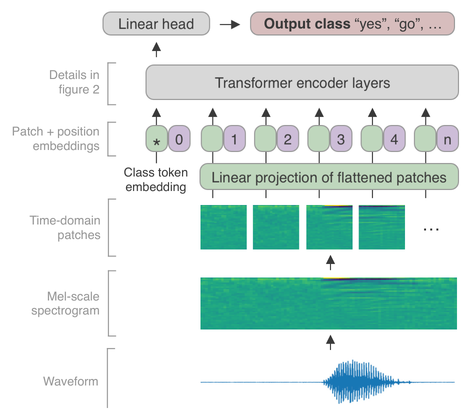

左图为 KWT 原论文架构，标出 Transformer 编码器。右侧以放大框标明赛题任务取数位置 **LN1 → FFN1**，并在表格上方放公式 **Y[99×256] = X[99×64] × W[64×256] + b[256]**。

| 赛题任务 | 实现内容 | 验证要求 |
|---|---|---|
| 1｜乘累加与数值处理 | 64 项点积、偏置、舍入和溢出处理 | 常规、边界、复位与连续任务 |
| 2｜FFN1 加速器 | 参数装载、输入缓冲、矩阵计算、结果写回 | 依次切换 12 套参数，RTL 与整数模型逐位一致 |
| 3｜E203 SoC 集成与综合 | 固件驱动、数据交换、启动与完成管理 | SoC 仿真、约束与综合报告、完整任务周期 |

**页脚**　600 条统一评测样本，按 12 层分别汇总并取最大 NRMSE ≤ 3%。时序目标 150 MHz，新增面积上限 2.25 mm²。

**讲稿**　“左边是 KWT 原论文的模型图。本科的工作在每个编码器的第一线性层：每个输出是六十四项乘积加一个偏置，一次做完九十九行、二百五十六列。赛题要求先验证数值模块，再完成十二套参数切换和结果写回，最后把加速器接入 E203，提交综合和性能证据。”

**制作说明**　保留论文图内的原始处理标注，另注“赛题按指定 checkpoint 从 LN1 提取输入”。论文图说明模型位置，右表说明赛题实现范围。完整 FFN、注意力和十二层编码器放拓展页。评分分配可放备答：功能与数值精度 40 分、SoC 集成与复现 20 分、吞吐 8 分、功耗与能耗 8 分、面积 4 分、自主创新 20 分。[赛题指南，第 7–12 页](../芯片设计赛题指南.pdf) · [Berg et al., Interspeech 2021，Fig. 1](https://arxiv.org/pdf/2104.00769#page=1)

## 03｜计算与搬运要同时提速 · 30 秒

**上屏文案**

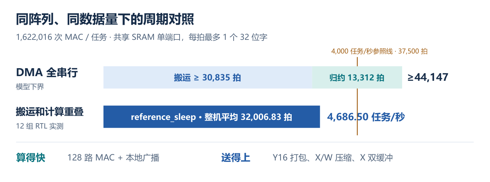

- **计算预算**　每任务 **1,622,016 次 MAC**。32 路即使满利用也需 **50,688 拍**。8×8 阵列每个 PE 同时处理偶、奇两个 k，每拍 **128 次乘加**。
- **通路预算**　单端口共享 SRAM 每拍最多一个 32 位字。平均载荷访问至少 **30,835 拍**，所以依次用 **Y16 打包、X/W 无损压缩、X 双缓冲**压缩或隐藏搬运开销。
- **周期对照**　固定阵列和数据量，DMA 若全串行，至少 **44,147 拍**，150 MHz 下至多 **3,398 任务/秒**。主方案采用重叠调度，12 组整机 RTL 平均 **32,006.83 拍**，折算 **4,686.50 任务/秒**。

**讲稿**　“先算预算。每任务一百六十二万次乘加，三十二路即使满负荷也要五万多拍，所以我们提高并行度。但每拍总线只有一个字，光数据搬运就至少三万零八百三十五拍。若把搬运和归约完全串起来，至少四万四千拍。我们减小传输量、把下一块装载放进当前块的计算窗口，整机平均做到三万二千拍。”

**制作说明**　把原第 9 页前移。上条按分析模型画，下条用整机实测实色绘制，标清口径。可在备答放报告 Roofline，沿用 **19.2 GMAC/s 阵列峰值、0.60 GB/s 理想总线带宽**。4,000 任务/秒只作为设计参照，周期预算为 37,500 拍。

**备答｜可复算口径**　全串行模型假定同一阵列与同一批压缩载荷，Host 装载、DMA 全部数据读写与 MAC 活跃拍互斥。理想搬运量为 `2 × (2,419.5 + 6,406 + 256) + 12,672 = 30,835` 个字，归约为 `13 × 32 × 32 = 13,312` 拍，合计 `44,147` 拍，忽略配置、背压和协议额外开销。实测从首个 Host 请求到最后一笔写响应。保留“全串行下界”和“重叠 RTL 实测”的标识。无 DMA 的 CPU 逐字搬运与 RTL 关闭重叠都缺同条件实测记录。

**备答｜主方案实测分解**　Host 与启动 9,588.00 拍，LOAD 6,792.67 拍，RUN 15,623.17 拍，其他 3.00 拍（分项各自舍入）。RUN 内有效归约 13,312 拍，已经包含在 RUN 区间。

[可编辑周期图](assets/front_end_revision/ffn1-cycle-budget.drawio) · [报告 Roofline](assets/front_end_revision/report-ffn1-roofline.png) · [设计报告表 3.9、表 6.2–6.3](https://github.com/hhaxi/keyword_transfomer_accelerator/blob/26f715dc25a873ccb3f865f132093745b9ce3939/report/kwt-design-report.pdf)

## 04｜项目进展与核心指标 · 20 秒

**上屏文案**

| 进展 | 已取得的验证或实现结果 |
|---|---|
| 数值模型及参数转换 | 冻结 X16/W16、偏置 INT32、ACC40、Y16。9,982 条开发样本 × 12 层，最差层 NRMSE **0.022189%** |
| 计算核与 DMA | 覆盖数值边界、解码、总线背压、错误排空及恢复。完成 128 路 MAC、双缓冲和 IRQ/WFI 集成 |
| 真实 E203 整机 | 复位、连续各 12 组任务，每种模式 **304,128 项 ACC40 + 304,128 项 Y16** 逐位一致 |
| 后端实现 | 已有 DC 综合与代表层 RTL-SAIF。Setup WNS **0.00 ns**，SS Hold WNS **−0.17 ns**，683 条保持违例 |
| 拓展与上板 | 紧凑单路 12 层 ASIC 综合，Z100 单路版 **55.56 MHz** 上板，分类与定点参考 **120/120 一致** |

**基础 FFN1 指标卡**

| 平均周期 / 吞吐 | 新增 / 整机单元面积 | 第 4 层 SoC 平均功耗 / 能量 |
|---|---|---|
| **32,006.83 拍 / 4,686.50 任务/秒**，150 MHz 折算，约 **15.20 GOPS** | **0.505555 / 2.738203 mm²**，新增占预算 **22.47%** | **37.346 mW / 7.6038 µJ**，窗口 **30,540.5 拍** |

**讲稿**　“从数值转换到真实 E203 整机，十二组任务在复位和连续两种情况下都通过逐位核对。基础方案平均三万二千拍，新增单元面积约零点五零六平方毫米，代表层能耗约七点六微焦。综合的建立时间无违例，慢角保持时间还有负裕量。十二层单路扩展也已在 Z100 上完成验证。”

**制作说明**　上半区做五步进展带，下半区放三张指标卡。FFN1 采用报告版 `reference_sleep`，功耗取指定第 4 层 RTL-SAIF 窗口，DC 当前为无 WLM 的布局布线前估算。拓展上板与 FFN1 ASIC 独立标注。[报告与指标](https://github.com/hhaxi/keyword_transfomer_accelerator/blob/26f715dc25a873ccb3f865f132093745b9ce3939/report/kwt-design-report.pdf) · [代表层 PPA](../report/evidence/ffn1-layer04-ppa.txt) · [紧凑单路 FPGA 记录](https://github.com/hhaxi/keyword_transfomer_accelerator/blob/26f715dc25a873ccb3f865f132093745b9ce3939/report/evidence/fpga-compact1-summary.md)

## 05｜系统架构与四项创新 · 20 秒

**上屏文案**

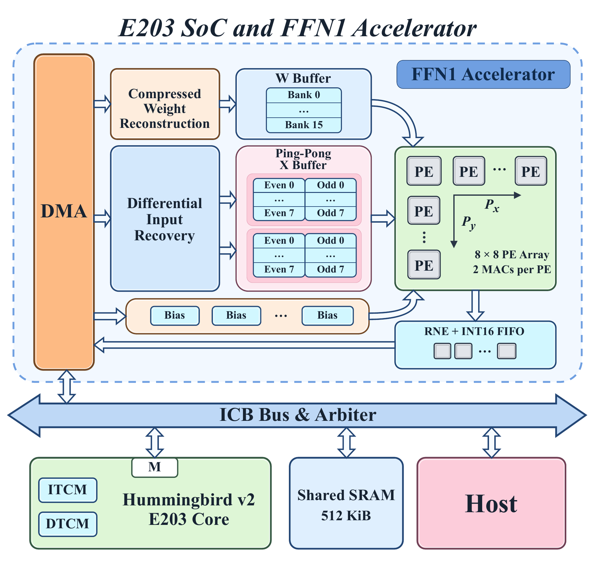

| 右栏创新点 | 对应图中位置 |
|---|---|
| **分块广播与本地复用**　8×8 PE，每个 PE 并行处理两个 k | PE 阵列、X/W 本地 bank |
| **传什么**　X 行差分、W 按列位宽传输，片内恢复 INT16 | DMA 后的 X/W 解码 |
| **何时传**　X 双缓冲，让下一块装载与当前块归约重叠 | X ping-pong bank |
| **怎样写回和等待**　Y16 双结果打包，末写响应后中断唤醒 E203 | 结果 FIFO 与 DMA、E203 |

**讲稿**　“左图是完整 SoC。右边四项对应四处硬件：阵列和本地 bank 提高复用，解码减少输入传输，双缓冲重叠装载，结果队列把两个输出打成一个字，写回结束再用中断唤醒处理器。下一页跟着一个任务走一遍。”

**制作说明**　原第 4 页改成总览。左栏约 58%，完整保留原第 5 页的系统图，右栏约 42%，在图上用细引线指向四处硬件。静态图建立全局方位，下一页只点亮本帧路径。

## 06｜一次 FFN1 任务怎样流过 SoC · 25 秒

**上屏文案**

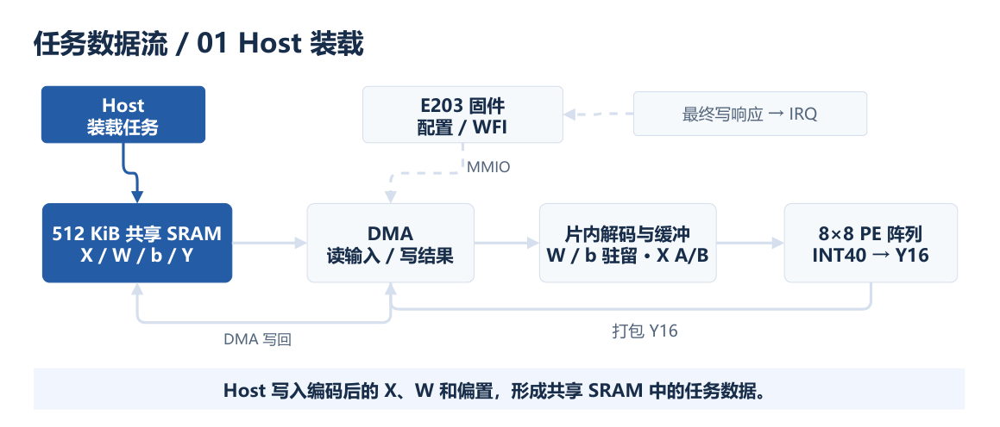

底部保留一条进度线 **Host 装载 → E203 启动 → DMA 读取与恢复 → 阵列计算和 Y 写回 → 完成中断**。

**讲稿**　“先看 Host 把输入和参数装进共享 SRAM。E203 写 MMIO 地址和启动位，随后等待中断。DMA 先装权重、偏置和首块输入，片内恢复后开始算。计算当前块时，DMA 预取下一块，同时把已完成的 Y 分时写回。最后一笔写响应回来，E203 才收到完成中断。”

**制作说明**　动图用同一拓扑逐帧高亮，蓝色表示数据装载或计算，虚线表示控制，青色表示写回与完成。帧 4 停留稍长，用于口播搬运重叠。现场可用逐步出现动画替代自动循环。讲稿以“同时推进”描述 RUN，单端口上的 X 读与 Y 写分时受理。[可编辑 Draw.io 五帧](assets/front_end_revision/ffn1-task-dataflow.drawio) · [静态备用图](assets/front_end_revision/ffn1-task-dataflow-still.png)

## 07｜X 行差分与双缓冲 · 35 秒

**左栏｜发送差值，片内恢复原值**

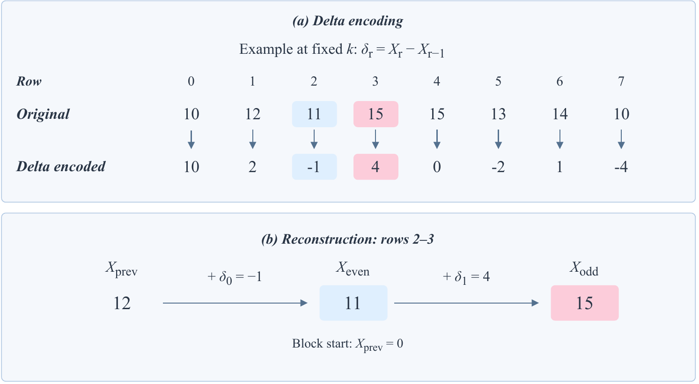

X 以行块组织。块首行相对 0 编码，后续行传相邻行差值。头部记录每行位宽，片内解包、符号扩展并加回预测值，恢复原有 INT16。示例 **12 → 11 → 15** 对应 **12、−1、+4**。

**右栏｜A/B 交替装载与读取**

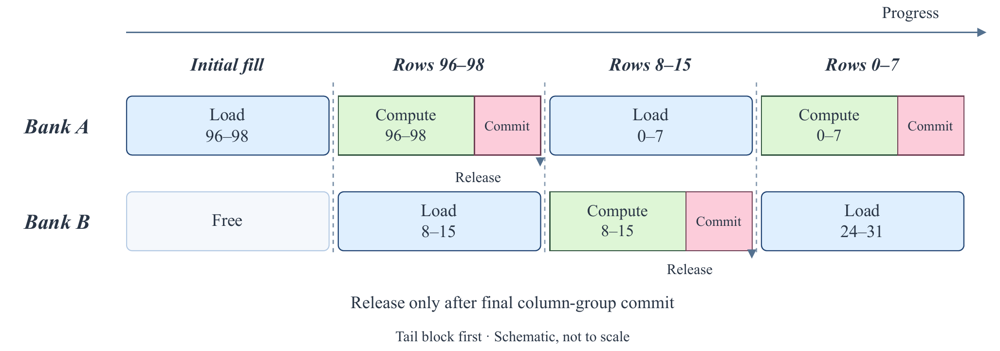

阵列读 A、DMA 写 B。B 准备好且 A 读完后交换角色。满重叠的一个行块交接区间由 **T计算 + T装载** 缩为 **max(T计算, T装载)**。

**页底数据**　平均 X 输入从 **3,168 → 2,419.5 个 32 位字**，包含压缩头，降 **23.63%**。

**讲稿**　“先看输入。相邻行接近时，传差值可以少占几位。比如十二、十一、十五，传十二、负一和正四，片内加回后仍是原来的三个数。恢复的数据放进 A 或 B；阵列计算 A 时，DMA 把下一块填进 B。两块各自完成后交换。X 输入平均从三千一百六十八字降到两千四百二十字左右。”

**备答**　报告的 X 差分与并行恢复开关对照，关闭差分和尾块优先时为 **33,335.00 拍**，仅开启差分及并行恢复时为 **31,812.33 拍**，平均少 **4.57%**。两组保留既有双缓冲，数据属于 X 路径消融。尾块调度讲解见第 11 页。

[报告第 3 章及创新对照](https://github.com/hhaxi/keyword_transfomer_accelerator/blob/26f715dc25a873ccb3f865f132093745b9ce3939/report/kwt-design-report.pdf) · [四组本地开关对照](evidence/xdelta-cycles.json)

## 08｜8×8 PE 阵列如何用足 128 路乘加 · 30 秒

**左图｜八行 X 横向广播，八列 W 纵向广播**

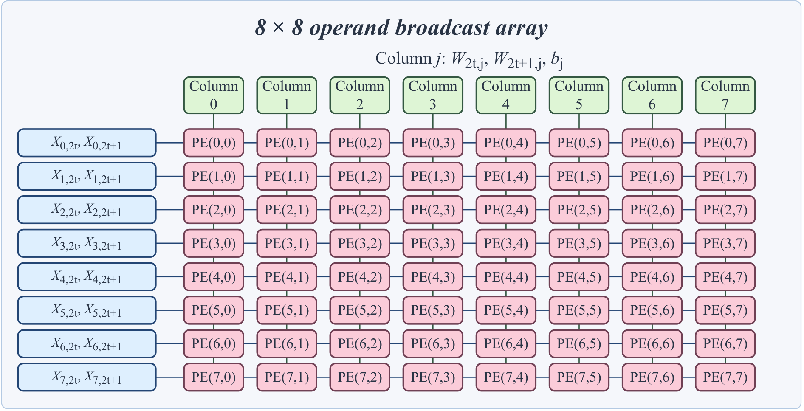

每行两个 X，横向供 8 个 PE 共用。每列两个 W，纵向供 8 个 PE 共用。

**右图｜一个 PE 每拍归约两项**

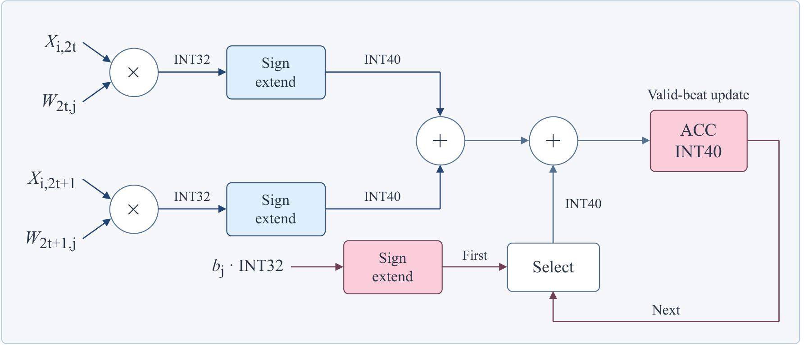

首拍加偏置，后续拍加本地部分和。一个输出的 64 项点积需要 **32 个有效计算拍**。

**页底结论**　片内每拍读 **16 个 X + 16 个 W**，供 64 个 PE、共 **128 次乘加**。

**讲稿**　“左图看数据怎么复用。同一行的两个 X 横向广播，同一列的两个 W 纵向广播，分别供八个 PE 共用。右图放大单个 PE，眼下这两个操作数对应偶、奇两个 k，同时相乘并累加到本地 INT40。这样本地每拍读三十二个操作数，就能供一百二十八路乘加。”

**制作说明**　左右两图上缘对齐。左图用横向蓝线和纵向绿线各示意一条广播通路，右图用同色突出两组操作数，保留 INT40 反馈箭头；移除重复的长段图注，把 128 路结论放在统一页底。32 拍为归约有效拍，片内预取、提交和背压另计。[阵列图源](assets/front_end_revision/report-3-2-array.drawio) · [PE 图源](assets/front_end_revision/report-3-7.drawio)

## 09｜位宽取舍：精度与总线预算 · 35 秒

**上屏文案**

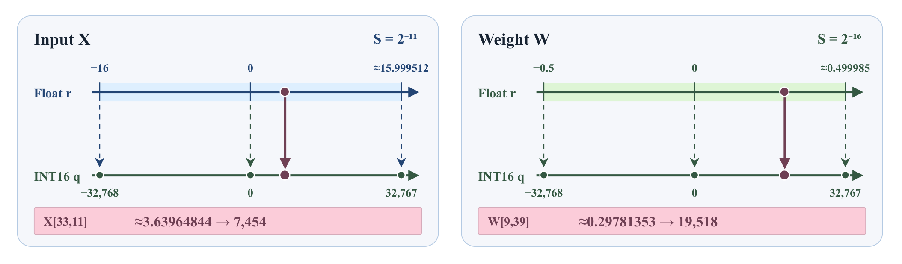

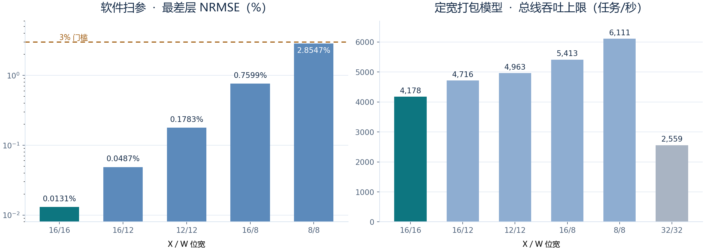

| X/W 位宽 | 600 条开发输入的 FFN1 最差层 NRMSE | 理想总线吞吐上限（任务/秒） |
|---|---:|---:|
| INT32 / INT32 | 缺同口径扫参记录 | 2,559 |
| **INT16 / INT16** | **0.013067%** | **4,178** |
| INT16 / INT12 | 0.048730% | 4,716 |
| INT12 / INT12 | 0.178259% | 4,963 |
| INT16 / INT8 | 0.759880% | 5,413 |
| INT8 / INT8 | 2.854708% | 6,111 |

**页底结论**　主方案选 **X16/W16 + INT32 偏置 + INT40 累加**，通过无损编码减少传输量。最终 **Y16** 写回后的最差层 NRMSE **0.022189%**，整机折算 **4,686.50 任务/秒**。

**讲稿**　“左图看浮点怎么映射到定点。右边两张图对照位宽：十六乘八和双八位减少了总线字，但误差明显增大。三十二位格式虽然位宽更大，固定总线下的传输上限却更低。我们选双十六位，保留四十位累加，再靠无损压缩减少字数。写回以后，主方案最差层误差约百分之零点零二二。”

**制作说明**　沿用前稿量化图的视觉语汇，左侧仅保留 X、W 的定点刻度示意，右侧两张柱图分别呈现 NRMSE（对数纵轴）和理想总线上限。表格放备答以免与图重复。INT32/INT32 在吞吐模型图展示，精度图留在有报告的五个硬件输入格式。FP32 是参考答案，其与自身比较的零误差不填到定点 INT32 行。

**备答｜比较口径**　精度来自同一批 600 条开发输入、同一 FP32 参考、12 层分别汇总的历史扫参。双 16 采用原逐张量方案（ID 0），其余展示逐输出通道方案（ID 46、26、42、2）。同轮逐列双 16（ID 49）为 0.011139%，逐张量双 8（ID 1）为 3.365339%。最终 Y16 的 0.022189% 来自独立的 9,982 条本地样本评估，含写回重新量化。

**备答｜吞吐模型**　所有格式假设固定 Y16 与 INT32 偏置、X/W 理想定宽打包、共享 SRAM 一字/拍、Host 先写入且 DMA 再读一次。公式 `150 MHz / [2 × (6336×Xbits/32 + 16384×Wbits/32 + 256) + 12672]`，忽略计算、等待与控制，无压缩。INT12 跨字拼接只体现在模型中。当前工程的 4,686.50 属于压缩后的实测周期折算。各扫参格式未做同条件 RTL 整机吞吐或 PPA。

[历史 50 组格式扫参摘要](evidence/ffn-precision-decision.md) · [完整扫参表](evidence/ffn-format-sweep.md) · [最终 Y16 精度评估](evidence/int16-accuracy.md) · [量化图源](assets/front_end_revision/report-ffn1-operand-quantization.drawio)

## 10｜写回量化：INT40 到 INT16，一字两结果 · 25 秒

**上屏文案**

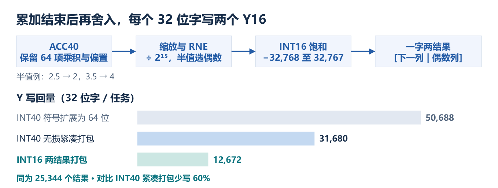

- **怎么舍入**　累加完成后除以 2¹⁵，按最近偶数舍入，再饱和到 INT16。例：**2.5 → 2，3.5 → 4**。
- **怎么打包**　同一行的相邻两列写入一个 32 位字。低半字放偶数列，高半字放下一列。
- **量化前后**　每任务都输出 25,344 个标量。**INT40 紧凑打包 31,680 字 → Y16 12,672 字**，总线写回量降 **60%**。

**讲稿**　“这一页接着讲量化。点积全程留在四十位，算完才缩放。碰到恰好一半时取最近的偶数，所以二点五取二，三点五取四。饱和得到十六位后，相邻两列合在同一个字里。与四十位紧凑写回相比，结果个数相同，总线少写六成。”

**制作说明**　在上方流程图旁用等宽格表现 32 位字高低半字，下方三根横条分别标出旧 64 位符号扩展写回、40 位无损紧凑打包和当前 16 位打包。第 09–10 页连续讲，第 09 页说明为什么选这个格式，第 10 页解释如何落到硬件和写回流量。最近偶数舍入由低 15 位与半值比较及截取结果的奇偶决定。图中流量是纯 Y 写回字数。[可编辑图](assets/front_end_revision/ffn1-output-writeback.drawio) · [Y16 写回与精度记录](evidence/int16-accuracy.md)

## 11｜DMA 调度、尾块优先与完成条件 · 30 秒

**上屏文案**

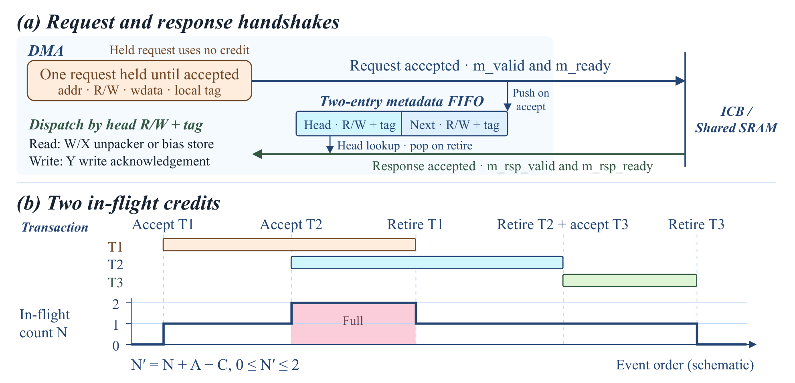

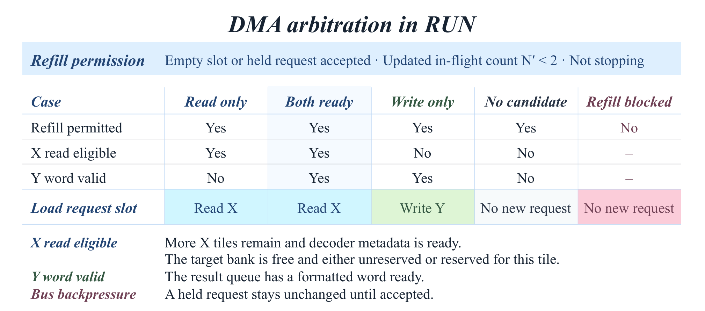

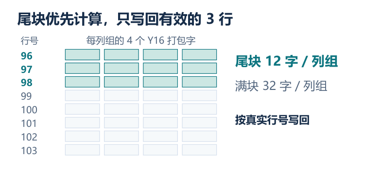

| 看图顺序 | 要讲清楚的行为 |
|---|---|
| **发请求** | 最多两笔在途，响应按接纳顺序退休。请求被背压时保持地址、方向和数据 |
| **排读写** | LOAD 先装 W、偏置和首块 X。RUN 中有空缓冲且下一块未装完时发 X 读取，其余窗口写 Y |
| **处理尾块** | 99 行分为 12 个满块和 1 个三行尾块。96–98 行优先执行，每个列组只写 **3×4=12 字**，满块写 **8×4=32 字** |
| **判断完成** | 用真实行与列对索引写回行主序 SRAM。等待末笔写响应退休、队列及在途排空，再置 done 和 IRQ |

**讲稿**　“DMA 最多保留两笔在途请求。下一块有空缓冲就先预取，阵列用当前块计算时把余下的总线时隙留给 Y。九十九行除以八，会剩三行；我们先做这三行，写回只发有效结果，地址仍按真实行号生成。等最后的写响应返回，CPU 才收到完成通知。”

**制作说明**　左侧放报告主图，右上只截 RUN 优先选择节点，右下用 8 行小矩阵把第 96–98 行着色，灰掉 5 行，并标“每列组 12 字”。若需要再省空间，完整请求与响应图可放备答，正文保留报告调度图和尾块小图。

**备答**　主方案使用读优先。先装三行尾块即可开算，把其余满块留到 RUN 阶段预取。报告尾块单开关实测 **33,335.00 → 33,315.25 拍**，在启用 X 差分及并行恢复后，叠加尾块优先为 **31,812.33 → 31,794.25 拍**。尾块仍按统一阵列几何归约，`valid_rows=3` 控制结果移交和写请求。另有候选 `dense → dense_sched` 写优先的同组调度实验，连续平均 **31,561.92 → 31,487.92 拍**，节省 **74 拍**，作为不同候选的备答证据。

[报告 DMA 通路图源](assets/front_end_revision/report-4-1.drawio) · [RUN 调度图源](assets/front_end_revision/report-dma-rw-flow.drawio) · [尾块图源](assets/front_end_revision/ffn1-tail-tile.drawio) · [报告第 3、4 章与创新对照](https://github.com/hhaxi/keyword_transfomer_accelerator/blob/26f715dc25a873ccb3f865f132093745b9ce3939/report/kwt-design-report.pdf)

## 12｜分层验证工具链 · 35 秒

页面沿用验证工具链版的三条泳道。左侧统一冻结 RTL、编译宏、SRAM 模型、十二组层参数与 E203 固件。

| 验证层次 | 工具与检查 |
|---|---|
| 静态质量与低功耗 | SpyGlass Lint / Power，原始检查报告待补 |
| 动态功能与覆盖率 | VCS 运行模块与 SoC 仿真，Verdi 查看握手和背压，URG 汇总代码覆盖率 |
| 数值精度与一致性 | Python/NumPy 生成整数期望，SV testbench 比对 ACC40 和 Y16。浮点参考用于计算 NRMSE |

**讲稿**　“同一组 RTL、固件和参数输入到验证流程。动态仿真检查握手和状态，也对计算与写回各比对 25,344 个整数。浮点参考用于衡量量化误差。SpyGlass 在这里展示静态检查环节，原始报告仍待补齐。”

**来源**　报告表 5.1、5.3，PDF 第 45–47 页。

## 13｜验证证据与问题定位 · 35 秒

| 旧版布局 | 本次展示内容 |
|---|---|
| A · VCS 候选回归日志 | dense_sched 的复位与连续模式各 12 / 12 通过。[原始日志截图](assets/backend_20261119/一致性对比.png) |
| B · 主方案逐位回归 | Q128 reference_sleep 两种模式各 12 个任务。每种模式的 304,128 项 ACC40 与 304,128 项 Y16 均逐位一致 |
| C · VCS 代码覆盖率 | tb_soc/dut 层次，Line 91.91%、Toggle 71.63%、FSM 46.15%、Condition 71.72%、Branch 82.47%。[覆盖率截图](assets/backend_20261119/覆盖率检查.png) |
| D · Verdi 波形 | 左图为偏置预取、PRIME 和首拍累加，右图为 EMIT 阶段背压与恢复。[波形原图](assets/backend_20261119/仿真波形.png) |

**讲稿**　“左上是候选调度的补充日志，中间是主报告方案的逐位回归结果。右上显示代码覆盖率，下方两段波形展示偏置预取、首拍累加，以及输出背压结束后恢复推进。”

**证据范围**　主方案数据来自报告表 5.3。覆盖率与波形截图的编译宏、源码指纹和运行批次待核对。SpyGlass 原始材料待补，B 区采用主报告的逐位回归数据。

## 14｜综合约束与方法 · 40 秒

| 工艺、约束与活动 | 设置 |
|---|---|
| 顶层 | kwt_ffn1_soc，含 E203、TCM、互连、512 KiB 共享 SRAM 与 FFN1 |
| 标准单元与宏库 | SMIC40 SCC40NLL VHSC40 RVT SS，RAMSP 单端口 SRAM SS，0.99 V、125 °C |
| 工艺映射与门控 | `compile_ultra -gate_clock -no_autoungroup`，门控最小位宽 8、最大扇出 64 |
| 时钟与不确定度 | core_clk 6.666667 ns（150 MHz），Setup / Hold uncertainty 各 0.100 ns |
| 转换时间 | 时钟 0.050 ns，输入 0.100 ns |
| I/O 与负载 | delay max / min 1.000 / 0.000 ns，输出负载 0.020 pF |
| 时钟门控 | 255 个门控单元，9,763 / 10,005 个寄存器被门控（97.58%） |
| RTL-SAIF | 第 4 层完整任务 30,540.5 拍、203.603 µs。6,898 / 10,065 个时序单元（68.53%），端口 141 / 141，保留 227 条 PWR-19 冲突 |

**WLM**　库报告显示 `No wire loading specified`，`default_wire_load` 属性缺失。`Wire Loading Model Mode: top` 表示模型的应用层次设置。此前尝试启用 WLM 的运行在读取模型时停止，现有结果采用无 WLM 的布局前口径，`Net Interconnect area` 为 `undefined`。

**讲稿**　“用四十纳米慢角标准单元和同角 SRAM 宏做 DC 综合。目标时钟六点六七纳秒，约束包含不确定度、输入输出延迟和负载。DC 自动插入门控，功耗标注取自第 4 层完整 RTL 任务。当前库报告没有可用线负载模型，这组结果采用无 WLM 的布局前口径。”

**来源**　报告表 5.7、6.3–6.6 和服务器 WLM 日志。[PPA 摘录](../report/evidence/ffn1-layer04-ppa.txt) · [Draw.io 流程图](assets/backend_20261119/synthesis-flow.drawio) · [任务窗口图](assets/backend_20261119/task-window.drawio)。

## 15｜综合结果与报告截图 · 45 秒

| 项目 | Q128 reference_sleep，150 MHz | 截图 |
|---|---|---|
| 面积 | 新增 **0.505555 mm²**，占 2.25 mm² 预算的 22.47%。整机 **2.738203 mm²**，含 132 个 SRAM 宏 | [面积原图](assets/backend_20261119/面积.png) |
| 时序 | Setup WNS / TNS **0.00 / 0.00 ns**，0 条违例。SS Hold WNS / TNS **−0.17 / −33.14 ns**，683 条违例 | [Setup slack 原图](assets/backend_20261119/时序.png) |
| 功耗 | 第 4 层整机平均 **37.346 mW**，动态 32.936 mW，漏电 4.410 mW，单任务 **7.6038 µJ** | [功耗原图](assets/backend_20261119/功耗.png) |

**讲稿**　“新增单元面积约零点五零六平方毫米，占预算约百分之二十二点五。建立时间在报告精度下无违例，慢角保持时间仍有六百八十三条违例。第 4 层完整任务的平均功耗约三十七点三五毫瓦，乘以二百零三点六微秒的任务窗口，得到约七点六零微焦。”

**备答数据**

- 新增口径包括新增逻辑、接口和内部 SRAM。E203 含 ITCM / DTCM，面积 0.470254 mm²。共享 SRAM 层级面积 1.762394 mm²。整机 SRAM 宏合计 2.444136 mm²，占整机 cell 面积 89.26%。Buf/Inv 是组合面积子集。[面积构成图](assets/backend_20261119/area-composition.drawio)
- 时序截图展示 required、arrival 和 slack，路径组及 WNS、TNS 和路径数采用报告表 6.5。Hold 需继续修复并补充快角及布局布线后检查。
- 开关与内部功耗为 9.703 和 23.233 mW。截图的漏电列单位为 µW，层次表顶层 37.345 mW 与报告摘要 37.346 mW 相差 0.001 mW，来自显示舍入。层次总功耗为加速器 28.801 mW（77.1%）、共享 SRAM 7.431 mW（19.9%）、E203 含 TCM 1.005 mW（2.7%）。
- 报告表 13.3 单独记录 IRQ/WFI 的 task00 对照，动态功耗下降 5.81%，能量下降 4.50%，周期约增加 0.68%。

**来源**　报告表 6.4–6.6、图 6.3、[PPA 摘录](../report/evidence/ffn1-layer04-ppa.txt)。

## 16｜综合前后形式等价验证 · 25 秒

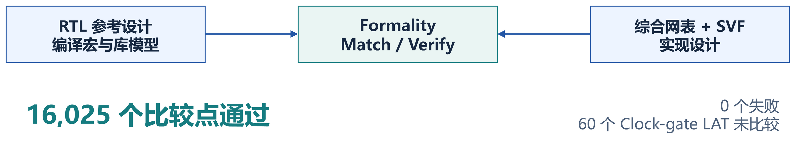

| 比较点 | 通过 | 失败 |
|---|---:|---:|
| BBPin | 6,784 | 0 |
| Port | 67 | 0 |
| DFF | 9,174 | 0 |
| 合计 | **16,025** | **0** |

另有 **60 个 Clock-gate LAT 未比较**。已取得的摘要显示 `Verification SUCCEEDED`，同时保留 Auto Setup 与 RTL interpretation 提示。

**讲稿**　“已有形式等价摘要中，一万六千零二十五个比较点通过，没有失败点。六十个门控锁存器没有纳入自动比较。我们按摘要实际范围报告；完整运行记录及其与当前提交网表的批次对应关系仍需核对。”

**来源与限制**　报告表 5.8、[原始摘要](../report/evidence/formal-equivalence-summary.txt)、[证据范围说明](https://github.com/hhaxi/keyword_transfomer_accelerator/blob/26f715dc25a873ccb3f865f132093745b9ce3939/report/evidence/README.md)。不能据历史摘要宣称本轮 WLM 综合或全部门控状态已证明。[可编辑图](assets/backend_20261119/formal-flow.drawio)。

## 17｜拓展实现：十二层紧凑单路编码器 · 25 秒

| 同一紧凑单路 ASIC 配置 | 最新报告结果 |
|---|---:|
| 十二层任务周期 | 4,206,337 拍 |
| 150 MHz 折算吞吐 | 35.660 任务/秒 |
| 新增 / 整机 cell 面积 | 1.489217 / 3.727416 mm² |
| 整机 RTL-SAIF 功耗 | 100.643 mW |
| 单任务能量 | 2,822.256 µJ |
| Setup / SS Hold WNS | 0.00 / −0.17 ns |

**讲稿**　“拓展采用紧凑单路编码器，串起注意力、残差归一化和完整前馈网络。层间驻留、LN1 直传和逐层参数预装减少搬运。这里的任务是完整十二层，因此周期、面积和能量与基础 FFN1 分开统计。”

来源：报告第十章及 [编码器 PPA 摘录](https://github.com/hhaxi/keyword_transfomer_accelerator/blob/26f715dc25a873ccb3f865f132093745b9ce3939/report/evidence/encoder-compact1-ppa.txt)。

## 18｜FPGA 上板验证与实现资源 · 25 秒

| Z100 / XC7Z035-2FFG900 | 结果 |
|---|---:|
| PL 时钟 | 55.56 MHz |
| 编码输出逐位核对 | 12 × 6,336 = 76,032 个整数一致 |
| 板上时延中位数 | 75.62 ms |
| 连续端到端吞吐 | 12.66 条输入/秒 |
| LUT / FF / BRAM / DSP | 33,126 / 17,584 / 215 / 179 |
| Setup / Hold 裕量 | +0.182 / +0.038 ns |
| 预测与定点参考一致 | 120 / 120 |

**讲稿**　“单路版已在 Z100 上运行，实际 PL 时钟约五十五点六兆赫。最终编码输出逐位一致，板上中位时延约七十五点六毫秒，连续端到端吞吐约十二点六六条每秒。右侧资源与正时序裕量来自布线后记录，和 ASIC 目标频率分别统计。”

来源：报告第十一章及 [上板摘要](https://github.com/hhaxi/keyword_transfomer_accelerator/blob/26f715dc25a873ccb3f865f132093745b9ce3939/report/evidence/fpga-compact1-summary.md)。本轮未提供新的实拍，不生成或冒用板卡照片。

## 19｜基础 FFN1 指标汇总 · 25 秒

| Q128 reference_sleep | 最新报告口径 |
|---|---|
| 功能 | 十二组参数，复位与连续任务逐位一致 |
| 最差层汇总 NRMSE | **0.022189%**，9,982 条本地样本 |
| 平均任务周期 | **32,006.83 拍** |
| 150 MHz 折算吞吐 | **4,686.50 任务/秒**，约 15.20 GOPS |
| 新增 / 整机单元面积 | **0.505555 / 2.738203 mm²** |
| 第 4 层功耗 / 能量 | **37.346 mW / 7.6038 µJ** |
| Setup / SS Hold WNS | **0.00 / −0.17 ns** |

**讲稿**　“最后汇总最新版报告中的基础方案：精度满足本地门槛，十二组参数通过逐位检查，新增面积约零点五零六平方毫米。吞吐和代表层能量均按明确窗口统计。后续工作是修复保持违例、补齐线网模型，并完成物理实现检查。”

## 20｜备答：候选回归与统计口径 · 20 秒

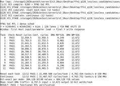

该截图为 `dense_sched` 候选对照：复位和连续各十二组任务 PASS，复位模式平均周期 31,496.5 拍，约 4,762 任务/秒。第 11 页备答中的写回优先调度收益也属于这一对照。主报告采用 `reference_sleep`，因此不将候选的周期、主报告的功耗和历史 Formality 摘要合写成一次实验。

## 证据与图形索引

| 资料 | 使用位置 | 范围 |
|---|---|---|
| user/面积.png | 15 | 与报告基础方案 cell 面积相符 |
| user/时序.png | 15 | slack 尾部截取，无完整路径起止点 |
| user/功耗.png | 15 | 层次表，Leak 为 µW |
| user/覆盖率检查.png | 13 | 代码覆盖率原图 |
| user/仿真波形.png | 13 | 预取、初始化、MAC、背压控制 |
| user/一致性对比.png | 13、20 | dense_sched 候选回归，单独统计 |
| report/ffn1-layer04-ppa.txt | 14–15、19 | 基础方案完整 PPA 摘录 |
| report/formal-equivalence-summary.txt | 16 | 历史形式等价摘要 |

前端可编辑图和 GIF 在 [前端配图目录](assets/front_end_revision/)，第 3 页为周期预算，第 6 页为数据流，第 9–10 页为位宽与写回，第 11 页为 DMA 与尾块。

六幅后端 Draw.io 图在 [assets/backend_20261119](assets/backend_20261119/)，均保留 `.drawio`、PNG、SVG 与视觉核对记录。正文图采用白底、深蓝标题和蓝绿强调；风险项用琥珀色，原截图不重绘。

## 后续需要补充的材料

- 与最终提交网表对应的完整形式等价日志、源码/网表哈希、Auto Setup 与 RTL interpretation 详情。
- Hold 修复、快角 STA 与布局布线后 RC；若获得真实 WLM，再以同库、同任务窗口重新综合并替换 PPA。
- 完整覆盖率命令、编译配置和未覆盖项分析；SpyGlass 检查需单独提供真实规则与报告。
