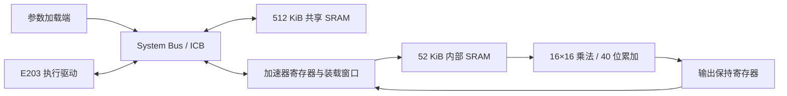

# 本科组前馈线性加速器设计

## 计算与资源

计算固定为 `Y[99,256] = X[99,64] × W[64,256] + b[256]`。一套硬件按软件调度顺序使用 12 层不同参数；每次完整任务重载参数和输入，不将不同层的计算交给 E203。

核心是一个有符号 16×16 乘法器和 40 位累加器。状态机按行、列、内积维度遍历，先同步读取偏置，再对 64 组操作数逐项读取和乘加。每个输出在保持寄存器中等待 E203 读走，背压期间累加结果不变。全部 25,344 个输出被取走后置位完成状态。

输入用两个 `16×4096` 单端口 SRAM，权重用四个 `16×4096` 单端口 SRAM；32 位偏置拆成两个 `16×1024` SRAM。共 53,248 字节（52 KiB），无额外 DDR 控制器。输入和权重同步读并行进行；读取与 MAC 分两个周期，避免将 SRAM 输出、乘法和累加放在同一个读周期中。是否满足指定工艺 150 MHz 仍须以映射后 STA 判定。

`rtl/kwt_sram16.sv` 是工艺替换边界。仿真为单周期同步读、同步写、无内容复位模型；通用综合保留为黑盒。官方宏接入时必须核对读延迟、片选、写使能、休眠信号及电源/时序模型，不能将黑盒面积或功耗计为零。

## 数值合同

冻结配置在 `model/format.json`，逐层指数由 checkpoint 和 LayerNorm 解析界限确定，没有从验证/测试样本调整尺度。另用 24 条训练划分样本进行无梯度标定检查，记录各层输入极值、饱和计数和数值误差；解析范围充足时不缩小尺度来追求训练样本上的更低误差。

- 对第 j 层，以 `max_i(|gamma_i|*sqrt(63)+|beta_i|)` 作为第一处 PostNorm 的输入绝对值界限。LayerNorm 的 epsilon 只会降低归一化幅度；再向上选取二进制尺度。
- `x_exp = ceil(log2(bound/32767))`；`w_exp` 同理使用该层权重最大绝对值。值表示为 `整数 × 2^exp`。
- 输入/权重：有符号 16 位。离线编码先最近偶数舍入，再饱和至 `[-32768,32767]`。
- 偏置：有符号 32 位，尺度 `2^(x_exp+w_exp)`；转换检查真实预训练偏置是否超范围。
- RTL 对 64 个有符号乘积作精确 40 位累加并加偏置，中间不截断、不重定标。合法输入的绝对结果小于 `2^37`，40 位有符号范围充足。
- 输出：40 位结果符号扩展到 64 位，低 32 位在前；软件按 `2^(x_exp+w_exp)` 解码。不能把输出误当作两个独立的浮点数。

`model/numeric.py` 提供与 RTL 对应的整数模型；`scripts/convert_task.py` 可以转换任意符合维度的输入张量，参考答案仅用于测试断言，不写入硬件或驱动。

`scripts/decode_output.py` 解码每行一个 64 位十六进制输出，检查 40 位符号扩展和 25,344 个结果的完整性，再按对应层指数还原浮点矩阵；可同时对输入 NPZ 中的浮点 `y` 计算 NRMSE。

指南 NRMSE 按每层全部样本的平方误差和参考平方和汇总，分母 RMS 下限 `1e-8`，最后取 12 层最大值。不能取逐样本 NRMSE 的平均代替指南定义。

## 寄存器和参数窗口

加速器 System Bus 基址为 `0x40000000`，ICB 命令与响应独立握手，至多一个未完成事务。配置/数据写必须为对齐 32 位全字写；错误访问响应 `rsp_err=1` 并置位 sticky fault，正在执行的合法任务继续。

| 偏移 | 访问 | 含义 |
| --- | --- | --- |
| `0x00000` | W | 写 2 中止/清理有效状态；写 1 启动 |
| `0x00004` | R | bit0 busy，bit1 done，bit2 output_valid，bit3 fault |
| `0x00008` | R | 从启动到最后一个输出被取走的核心周期计数 |
| `0x0000c` | R | 设计 ID `0x4b575431` |
| `0x00010` | R | 当前输出低 32 位，保持输出不弹出 |
| `0x00014` | R | 当前输出符号扩展高 32 位，接受读命令即弹出 |
| `0x10000 + 4*i` | W | X 的第 i 个元素，行优先，共 6336 个 |
| `0x20000 + 4*i` | W | W 的第 i 个元素，列优先，共 16384 个 |
| `0x30000 + 4*i` | W | b 的第 i 个 32 位元素，共 256 个 |

输入和权重在总线上每个 32 位字传输一个 16 位数据，硬件使用低 16 位。各窗口必须从索引 0 连续写入，窗口之间可以分别顺序装载。计数未达到完整长度时禁止启动；工作期间禁止改写参数。清理使全部参数失效，SRAM 内容不靠大规模复位清零；完整重载后才能使用。清理命令可用于超时恢复。

读到 `output_valid` 后先读低位、再读高位，并把两字写回共享 SRAM。重复读取低位不会弹出，读高位会弹出；无有效结果时读取数据寄存器返回总线错误。完成位只有最后一个结果被取走后有效，系统任务计时必须继续到 E203 完成最后一次共享 SRAM 写回。

## E203 集成与驱动

`integration/kwt_soc.sv` 直接实例化固定版本的 `e203_cpu_top`，通过其系统存储 ICB 接到 `kwt_system_bus`。上游 E203 源码和其既有 NICE 模块保持原样，本设计使用 System Bus 地址窗口。测试程序是真实交叉编译的 RV32IMAC ELF，由 E203 从共享 SRAM 取指执行；测试平台不替代 CPU 发出加速器运算命令。

本地集成包含 E203 CPU 顶层、系统互连、512 KiB 共享 SRAM 和加速器。未复制完整板级 GPIO/UART/PLL/常开域外设；它是对官方开源 CPU 参考的可运行集成基线，不能声称已经验证尚未发布的组委会平台工程。

结果由 E203 从加速器取出并写回共享 SRAM；加载端只提供输入参数，不执行必做矩阵运算。

共享 SRAM 为 `0xa0000000..0xa007ffff`：

| 地址 | 内容 |
| --- | --- |
| `0xa0000000` | 驱动固件，链接区 48 KiB |
| `0xa000e000` | 栈顶，栈向低地址增长 |
| `0xa000f000` | mailbox：0 等待、1 输入就绪、2 写回完成、`0xdead` 驱动错误、`0xbad` 异常 |
| `0xa000f004` | 驱动返回码 |
| `0xa0010000` | X，25,344 字节 |
| `0xa0018000` | W，65,536 字节 |
| `0xa0028000` | b，1,024 字节 |
| `0xa0030000` | Y，202,752 字节，结束于 `0xa0061800`（不含） |

主机加载端口只访问共享 SRAM；驱动负责从共享 SRAM 读参数、写加速器、启动、轮询、取结果并写回。代码没有矩阵乘法、预计算答案或浮点库依赖。正式平台接入时需要按平台分配地址并保留同样的协议和计算配置。

## 性能统计与验收范围

`tests/tb_soc.sv` 每次任务前复位有效缓存状态并清空输出区；复位/清空时间不计入任务时间。计时从主机经总线开始装载 X/W/b 到共享 SRAM 开始，到 E203 写回所有输出并通知 mailbox 完成为止；还包含完成通知的轮询观测延迟。因此包括加载端口、E203 搬运和调度、总线等待、硬件计算及写回，不使用纯 MAC 周期冒充整任务吞吐。

报告中的任务/秒由周期按 150 MHz 目标频率折算，仅当正式 STA 达标后才可作为该频率下的有效吞吐。所选 12 个本地性能任务各覆盖一层参数，并非冻结后组委会抽取的 12 个任务。

面积统计应为加速器、其新增接口逻辑及 8 个内部 SRAM 宏之和；E203、512 KiB 系统 SRAM 和固定互连单列。功耗应包含 E203、加速器、互连及 SRAM；必须对活动标注覆盖和 SRAM 功耗建模进行检查。当前缺少官方库和统一条件，因此物理面积、功耗、能耗和时序裕量均保持未验证，不能从通用门数推算正式成绩。
