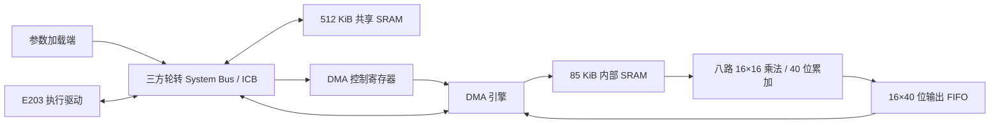

# 本科组前馈线性加速器与完整 FFN 设计

第五版在保留独立第一线性层的同时，增加完整 FFN 运行模式。完整模式的数值、控制及验证细节见 [完整 FFN 报告](full-ffn.md)。下面先说明共用的第一线性层路径，再列出当前接口。

## 计算与资源

计算固定为 `Y[99,256] = X[99,64] × W[64,256] + b[256]`。一套硬件按软件调度顺序使用 12 层不同参数；每次完整任务重载参数和输入，不将不同层的计算交给 E203。

第一线性层路径使用八路有符号 16×16 乘法器和 40 位累加器，共享一个输入，同步计算同一行的八个相邻输出列。首组用 16 周期读取八个偏置；之后在当前组 MAC 的前 16 周期预取下一组偏置到 8×32 位寄存器。每组在 PRIME 同步初始化八路累加器并读取首项，然后执行 64 次有序乘加，最后将八个结果入队。无背压时为初始 16 周期加每组 66 周期，共 3,168 组；所有累加次序和数值格式与前三版一致。

输出使用 16×40 位寄存器 FIFO（640 位有效载荷），每次入队八项。DMA 通过 valid/ready 接收完整的符号扩展 64 位结果，用一个 64 位保持寄存器拆成两个 32 位 SRAM 写事务；计算与写回重叠。空闲位置少于八项时，MAC 保持结果并等待。FIFO 有效数量在中止/复位时清空，数据和偏置预取寄存器不要求复位；首组总会重新填满偏置后才使用。核心取完 25,344 项只代表计算流完成，系统 done 必须等到最后一个共享 SRAM 写响应返回。

输入用两个 `16×4096` 单端口 SRAM，按线性元素索引奇偶分 bank，地址为 `index/2`。权重按 `lane=column%8`、`parity=k%2` 分为十六个 `16×1024` 单端口 SRAM，地址为 `(column/8)*32+k/2`。32 位偏置拆成两个 `16×1024` SRAM。以上为第一层所需的 20 个宏、53,248 字节。第五版另增加 16 个权重宏、2 个偏置宏和 2 个行缓冲宏，共 40 个宏、87,040 字节（85 KiB），无额外 DDR。两套权重之间复用八路 MAC，完整模式每行依次执行两层，GELU 中间行缓冲为 512 字节。DMA 的一个紧凑字同时写入两个奇偶 bank；计算时只读当前奇偶 bank，X 广播给八路 MAC。宏容量与宏面积不能直接等同，小宏的外围电路需按官方宏数据计入。同步 SRAM 输出到乘法/累加仍是一条寄存器间路径，150 MHz 须以工艺映射后 STA 判定。

`rtl/kwt_sram16.sv` 是工艺替换边界。仿真为单周期同步读、同步写、无内容复位模型；通用综合保留为黑盒。官方宏接入时必须核对读延迟、片选、写使能、休眠信号及电源/时序模型，不能将黑盒面积或功耗计为零。

## 数值合同

冻结配置在 `model/format.json`，逐层指数由 checkpoint 和 LayerNorm 解析界限确定，没有从验证/测试样本调整尺度。另用 24 条训练划分样本进行无梯度标定检查，记录各层输入极值、饱和计数和数值误差；解析范围充足时不缩小尺度来追求训练样本上的更低误差。

- 对第 j 层，以 `max_i(|gamma_i|*sqrt(63)+|beta_i|)` 作为第一处 PostNorm 的输入绝对值界限。LayerNorm 的 epsilon 只会降低归一化幅度；再向上选取二进制尺度。
- `x_exp = ceil(log2(bound/32767))`；`w_exp` 同理使用该层权重最大绝对值。值表示为 `整数 × 2^exp`。
- 输入/权重：有符号 16 位。离线编码先最近偶数舍入，再饱和至 `[-32768,32767]`。
- 偏置：有符号 32 位，尺度 `2^(x_exp+w_exp)`；转换检查真实预训练偏置是否超范围。
- RTL 对 64 个有符号乘积作精确 40 位累加并加偏置，中间不截断、不重定标。合法输入的绝对结果小于 `2^37`，40 位有符号范围充足。
- 输出：40 位结果符号扩展到 64 位，低 32 位在前；软件按 `2^(x_exp+w_exp)` 解码。不能把输出误当作两个独立的浮点数。

`model/numeric.py` 提供与 RTL 对应的整数模型；`scripts/convert_task.py` 可以转换任意符合维度的输入张量，参考答案仅用于测试断言，不写入硬件或驱动。

`scripts/decode_output.py` 解码每行一个 64 位十六进制输出，检查 40 位符号扩展和 25,344 个结果的完整性，再按对应层指数还原浮点矩阵；可同时对输入 NPZ 中的浮点 `y` 计算 NRMSE。

指南 NRMSE 按每层全部样本的平方误差和参考平方和汇总，分母 RMS 下限 `1e-8`，最后取 12 层最大值。不能取逐样本 NRMSE 的平均代替指南定义。

## 第五版 DMA 寄存器

System Bus 基址仍为 `0x40000000`，现在映射 `rtl/kwt_dma.sv`。ID 为 `KWT5`，新增模式及第二层配置寄存器，必须使用配套驱动。命令/响应独立握手，响应可保持，响应被接收的同周期可接收下一条命令。配置写必须对齐且为 32 位全字写。

| 偏移 | 访问 | 含义 |
| --- | --- | --- |
| `0x00` | W | 1：校验地址后开始完整任务；2：中止并排空已有事务 |
| `0x04` | R | bit0 busy；bit1 done；bit2 DMA/核心错误；bit3 已中止；bit4 寄存器/配置访问错误 |
| `0x0c` | R | ID `0x4b575435` |
| `0x20` | RW | X 在共享 SRAM 中的起始地址，3,168 个紧凑 32 位字 |
| `0x24` | RW | W 起始地址，列优先，8,192 个紧凑 32 位字 |
| `0x28` | RW | b 起始地址，256 个 32 位字 |
| `0x2c` | RW | Y 起始地址，独立第一层 25,344 个或完整 FFN 6,336 个 64 位结果 |
| `0x30/0x34` | RW | W2/b2 地址，仅完整 FFN 模式使用 |
| `0x38` | RW | 0=独立第一线性层，1=完整 FFN，其他值启动时拒绝 |
| `0x3c` | RW | GELU 输入右移 `[4:0]`，输出右移 `[12:8]`，其余位须为 0 |
| `0x7c/0x80/0x84` | R | 第二层 MAC 周期、GELU 周期、GELU 饱和次数 |
| `0x40..0x78` | R | 15 项周期、事务及时间戳统计，详见 [第五版完整协议与性能](full-ffn.md) |

X/W 每个 32 位字承载两个相邻 16 位元素：先出现的元素在低 16 位，后一个在高 16 位；采用小端字节序。X 仍按行优先，W 仍按列优先；b 为 32 位有符号字，Y 为 64 位符号扩展结果。`x.hex/w.hex` 保留原逐元素参考，实际 SoC 加载 `x_packed.hex/w_packed.hex`。`pack_vectors.py`、导出和任意输入转换脚本均支持生成紧凑文件，打包只改变传输表示，不改量化。所有 DMA 地址必须 4 字节对齐，完整缓冲区必须落在 `[0xa0010000,0xa0080000)`，不得覆盖固件、栈和 mailbox；Y 不得与任一输入缓冲区重叠。硬件用上界减长度进行检查，防止地址回绕。工作期间修改地址或再次启动会返回总线错误并置位 bit4，当前任务继续。

每次启动先清空计算核的有效计数，再 DMA 读取独立第一层的 11,616 个或完整 FFN 的 19,872 个输入/参数字。所有读响应进入内部 SRAM 后才启动计算。DMA 每接收一个输出，按低字、高字顺序写入共享 SRAM；累计本模式所需的成功写响应后才置位 done（独立第一层 50,688、完整 FFN 12,672）。E203 不执行矩阵计算，也不逐字搬运输入或输出。

中止及总线错误会停止生成新请求，但已经以 valid 发出的请求必须保持到被接受；随后排空响应，再清空计算核并退出 busy。已完成的 SRAM 写入不会回滚，失败任务的输出必须丢弃。软件必须等待 busy 清零后再复用缓冲区；如果总线永久不响应，驱动返回 `-4`，此时需要系统复位才能安全复用。地址配置在中止后保留，复位清零；正常下一次启动清除错误标志和统计。

`kwt_accel` 的原 MMIO 端口保留给独立核心测试。在 `dma_mode=1` 时，该端口被禁用，只有 DMA 流接口可以装载、启动和取结果。它不直接映射到第五版 SoC 地址空间。原 MMIO 仍每字一个元素、逐个递增；DMA 流每字两个元素，地址指向首元素且每次递增 8（核心地址单位仍按每元素 4 字节编号），由奇偶 bank 同拍接收。

## E203 集成与驱动

`integration/kwt_soc.sv` 直接实例化固定版本的 `e203_cpu_top`，通过其系统存储 ICB 接到 `kwt_system_bus`。上游 E203 源码和其既有 NICE 模块保持原样，本设计使用 System Bus 地址窗口。测试程序是真实交叉编译的 RV32IMAC ELF，由 E203 从共享 SRAM 取指执行；测试平台不替代 CPU 发出加速器运算命令。

本地集成包含 E203 CPU 顶层、系统互连、512 KiB 共享 SRAM 和加速器。未复制完整板级 GPIO/UART/PLL/常开域外设；它是对官方开源 CPU 参考的可运行集成基线，不能声称已经验证尚未发布的组委会平台工程。

`kwt_bus_fabric` 在 E203、加载端和 DMA 三个主设备间轮转。共享 SRAM 仍为原来的同步单端口模型，不增加隐藏端口。全局保留一个响应槽，允许上一笔响应退役和下一笔请求接收同拍发生；无背压时可每周期接收一个 SRAM 请求。被目标设备阻塞的已发出命令保持授权，响应背压时保持数据与归属。持续有效的各主设备最多等待另外两个已获准事务，不保证下游无限背压时的有限周期延迟。

结果由 DMA 写回共享 SRAM；E203 负责地址配置、启动、错误处理和完成通知。加载端只提供输入参数，不执行必做矩阵运算，也不能访问加速器控制寄存器。

共享 SRAM 为 `0xa0000000..0xa007ffff`：

| 地址 | 内容 |
| --- | --- |
| `0xa0000000` | 驱动固件，链接区 48 KiB |
| `0xa000e000` | 栈顶，栈向低地址增长 |
| `0xa000f000` | mailbox：0 等待、1 第一层输入就绪、5 完整 FFN 输入就绪、2 写回完成、3 请求周期快照、4 快照就绪、`0xdead` 驱动错误、`0xbad` 异常 |
| `0xa000f004` | 驱动返回码 |
| `0xa000f008` | 完整 FFN 的 GELU 移位配置 |
| `0xa000f060/64/68` | 第二层 MAC/GELU/饱和快照 |
| `0xa000f020..0xa000f058` | 15 项周期快照，按寄存器 `0x40..0x78` 顺序 |
| `0xa000f05c` | 快照发布标志 `0x50524633` |
| `0xa0010000` | X，12,672 字节 |
| `0xa0018000` | W，32,768 字节 |
| `0xa0028000` | b，1,024 字节 |
| `0xa0030000` | Y，独立第一层 202,752 字节；完整 FFN 50,688 字节 |
| `0xa0062000` | W2，32,768 字节 |
| `0xa006a000` | b2，256 字节 |

主机加载端口只访问共享 SRAM；驱动在 fence 后启动 DMA，轮询完成，并在再次 fence 后发布 mailbox。主机停止计时后可写 mailbox=3 请求快照，等待变为 4 后读取；统计采样不影响任务计时。正式平台接入时须按其地址、仲裁、缓存一致性及 DMA 主端口规则调整。本地 E203 集成的 CPU/共享 SRAM 路径已验证，但尚不能代表官方平台已经允许该 DMA 接口。

## 性能统计与验收范围

`tests/tb_soc.sv` 每次任务前复位有效缓存状态并清空输出区；复位/清空时间不计入任务时间。计时从主机经总线开始装载 X/W/b 到共享 SRAM 开始，到 DMA 完成全部写回、E203 通知 mailbox、主机观察到完成为止。因此包括加载端口、E203 调度、DMA、总线等待、硬件计算及写回。快照请求和读取位于计时结束及逐位输出校验之后；当前比较脚本直接校验独立第一层测试平台与第四版哈希一致；时钟、主机事务握手、计时边界、轮询、复位和输出检查保持一致。打包文件另与原始向量逐元素核对。

报告中的任务/秒由周期按 150 MHz 目标频率折算，仅当正式 STA 达标后才可作为该频率下的有效吞吐。所选 12 个本地性能任务各覆盖一层参数，并非冻结后组委会抽取的 12 个任务。

面积统计应为计算核、DMA、新增接口/仲裁逻辑及 40 个内部 SRAM 宏之和，不能只报 `kwt_accel` 的核心面积；E203、512 KiB 系统 SRAM 和固定互连单列。功耗应包含 E203、加速器、互连及 SRAM；必须对活动标注覆盖和 SRAM 功耗建模进行检查。当前缺少官方库和统一条件，因此物理面积、功耗、能耗和时序裕量均保持未验证，不能从通用门数推算正式成绩。
