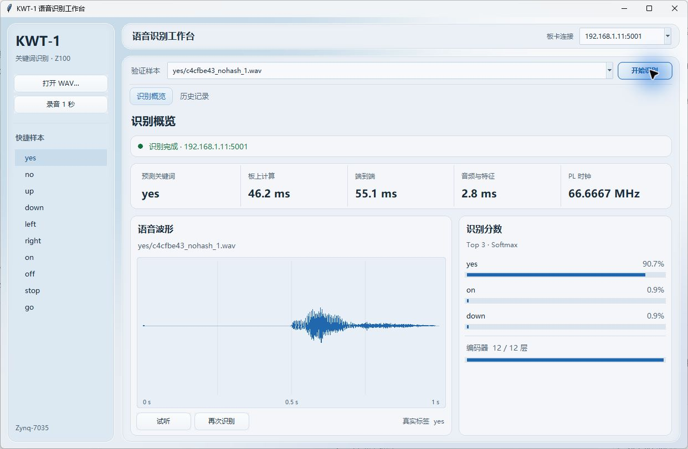
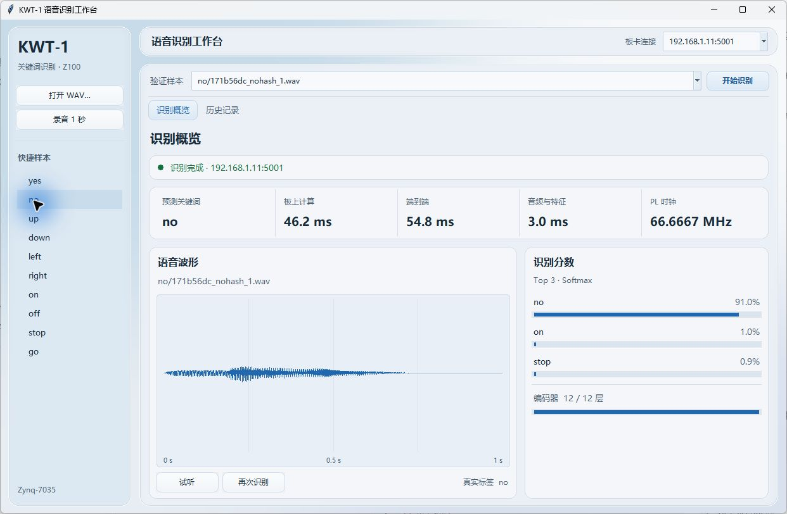
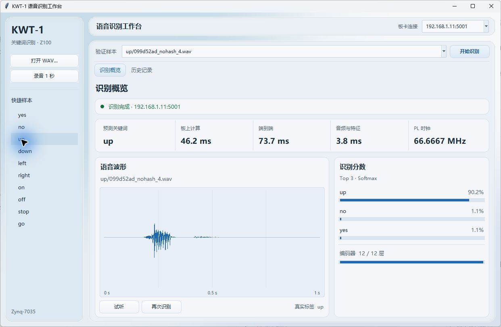
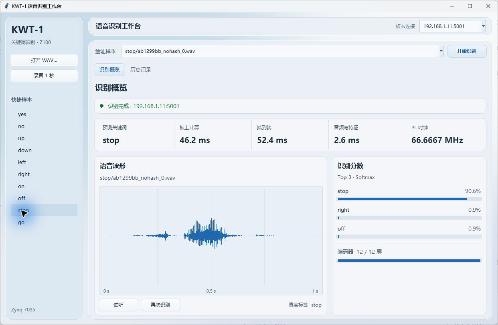

# Z100 FPGA 功能验证报告

按赛题组织的 E203、512 KiB 共享 SRAM 和逐层装载版本见 [赛题存储配置验证](contest-sram.md)。本页记录早期 Zynq DDR 演示版。

Z100 的 **XC7Z035-2FFG900** 以约 **66.7 MHz** 运行完整 12 层 KWT-1。Windows 上位机读取 Speech Commands V2 验证集 WAV，提取 MFCC 并完成嵌入，通过 PS 千兆以太网将 `99 × 64` Q16 特征送到板卡。PL 执行全部定点编码层，Cortex-A9 执行分类头并返回 logits、12 层进度和耗时。每个请求含 25,344 字节特征及帧头和 CRC32。

## 上位机实拍

下列截图来自连接真实 Z100 的桌面工作台。各样本均完成 12/12 层，预测与真值一致。截图中的端到端耗时包含新建 TCP 连接。

| 验证集 WAV | 预测 | Top-1 Softmax | 板上 | 端到端 |
| --- | --- | ---: | ---: | ---: |
| `yes/c4cfbe43_nohash_1.wav` | yes | 90.7% | 46.2 ms | 55.1 ms |
| `no/171b56dc_nohash_1.wav` | no | 91.0% | 46.2 ms | 54.8 ms |
| `up/099d52ad_nohash_4.wav` | up | 90.2% | 46.2 ms | 73.7 ms |
| `stop/ab1299bb_nohash_0.wav` | stop | 90.6% | 46.2 ms | 52.4 ms |

| yes | no |
| --- | --- |
| [](screenshots/yes.jpg) | [](screenshots/no.jpg) |
| **up** | **stop** |
| [](screenshots/up.jpg) | [](screenshots/stop.jpg) |

## 布线后资源

Vivado 2026.1，器件 `xc7z035ffg900-2`，顶层 `z100_wrapper`。统计覆盖完整 PL 设计，包括编码器、FFN 行调度和 AXI 集成。

| 资源 | 已用 | 可用 | 使用率 |
| --- | ---: | ---: | ---: |
| Slice LUT | 54,759 | 171,900 | 31.86% |
| Slice 寄存器 | 32,687 | 343,800 | 9.51% |
| Slice | 18,400 | 54,650 | 33.67% |
| Block RAM Tile（36 Kb 等效） | 296.5 | 500 | 59.30% |
| DSP48E1 | 633 | 900 | 70.33% |

LUT 包含 51,129 个逻辑 LUT、3,606 个分布式 RAM LUT 和 24 个移位寄存器 LUT。BRAM 使用 29 个 RAMB36E1 和 535 个 RAMB18E1，18 Kb 和 36 Kb 统计共享同一物理资源池。见 [Vivado 资源报告](evidence/kwt-66-utilization.rpt)。

| 主要实例 | LUT | FF | RAMB36E1 | RAMB18E1 | DSP48E1 |
| --- | ---: | ---: | ---: | ---: | ---: |
| 注意力、投影与 LayerNorm 编码器 | 27,863 | 11,377 | 0 | 234 | 402 |
| 7 路 FFN 行调度及计算 | 24,677 | 19,293 | 13 | 301 | 231 |
| DDR 桥和缓存 | 179 | 137 | 16 | 0 | 0 |

层级表展示主要实例，其余互连、寄存器和控制逻辑计入全设计总量。见 [层级资源报告](evidence/kwt-66-hierarchical-utilization.rpt)。

## 布线后时序

| 检查项 | 最差裕量 | 总负裕量 | 失败端点 |
| --- | ---: | ---: | ---: |
| Setup | WNS **+0.753 ns** | TNS 0.000 ns | 0 |
| Hold | WHS **+0.036 ns** | THS 0.000 ns | 0 |
| 脉宽 | WPWS **+6.731 ns** | TPWS 0.000 ns | 0 |

`clk_fpga_0` 的 STA 约束为 **14.999 ns（66.671 MHz）**，固件标称 66.666672 MHz，板上周期计数实测约 66.690 MHz。最差 setup 路径从编码器累加器到饱和计数器，数据路径延迟 13.625 ns，其中布线占 8.234 ns。未约束内部端点为 0。Bitgen DRC 无错误，常规 DRC 仍报告 DSP 流水线建议与 BRAM 异步控制警告。66.7 MHz 是本报告完成签收的频点。见 [时序报告](evidence/kwt-66-timing.rpt)、[DRC 摘要](evidence/kwt-66-drc-summary.rpt) 和 [板上时钟记录](evidence/clock.log)。

## 推理时延与吞吐

测试采用单板、单客户端、单请求在途。热连接组预热一次后逐条读取 WAV、计算特征、上传并等待完整分类结果。端到端包含上述各段，板上计时由 PL 周期计数换算，覆盖 12 层调度与分类头。录音入口的 1 秒采集和模型初始化在此 WAV 基准之外。

| 测试组 | 次数 | 端到端中位数 | P95 | 最大值 | 板上中位数 |
| --- | ---: | ---: | ---: | ---: | ---: |
| 40 MHz K4 TCP 原基线，热连接 | 12 | 305.73 ms | 308.37 ms | 308.37 ms | 293.27 ms |
| 66.7 MHz，热连接 | 12 | **50.70 ms** | 53.21 ms | 53.21 ms | 46.20 ms |
| 66.7 MHz，每次新建连接 | 12 | **51.98 ms** | 77.57 ms | 77.57 ms | 46.20 ms |
| 66.7 MHz，热连接持续测试 | 120 | **50.06 ms** | **51.18 ms** | **53.96 ms** | **46.20 ms** |

持续测试将固定 12 条 WAV 顺序运行 10 轮，120 次全部正确且低于 61 ms，实测总用时 6.027 s，**端到端吞吐为 19.91 次/秒**。按各样本的平均耗时换算，TCP 发请求至收结果的等效速率为 20.99 次/秒，板上计算的等效速率为 21.65 次/秒。后两项用于拆分延迟，持续吞吐以 19.91 次/秒为准。P95 按最近秩取值。

同批 12 条热连接对比中，端到端中位时延提速 **6.03 倍**，板上耗时约为 **308 万 PL 周期**。新版加宽 Q/K/V/O 投影与注意力，将 Softmax 和 LayerNorm 流水化，重叠 FFN 权重预加载并采用片上交接，同时将 TCP 接收窗口增至 32 KiB。新建连接组有 8/12 条低于 61 ms。

[原基线](evidence/baseline-latency.json) · [同批热连接](evidence/board-latency.json) · [逐次新建连接](evidence/board-latency-desktop.json) · [持续吞吐逐请求记录](evidence/throughput-120.json)

## 功能与数值验收

| 项目 | 结果 |
| --- | --- |
| COM8 联调 | 独立联调镜像在 115200 8N1 读回 PL ID 和版本，交替写读互补数据，计数器递增，坏 CRC 后合法请求成功。[串口日志](evidence/uart-smoke-115200.log) |
| 66.7 MHz 镜像的 JTAG 与 AXI 回读 | 检出 XC7Z035，读回 PL、编码器、FFN 的 ID，互补写读和周期计数检查通过。[JTAG 日志](evidence/board-jtag.log) |
| 冻结向量逐位核对 | 12 条，每条 6,336 个最终整数，共 **76,032 个**逐位一致。分类 logits 与上一版板卡一致。[冻结回读](evidence/board-frozen.json) · [上一版 logits](evidence/logits-baseline.json) · [新版 logits](evidence/logits-66mhz.json) |
| 固定 120 条验证样本 | **120/120** 与软件定点参考分类一致，**119/120（99.17%）** 与真实标签一致。其中 `on/4340d369_nohash_0.wav` 的软件和板卡均判为 `off`。[逐样本记录](evidence/board-validation.json) |
| 连续推理和错误恢复 | 坏 CRC 后重连，连续两次全量回读通过，两次均收到第 1 至 12 层进度。[恢复日志](evidence/board-recovery.log) |
| RTL 仿真 | 12 层投影、注意力、LN 与 FFN 接口校验，另有完整 AXI 集成路径、FFN 中止/DMA 故障恢复及整数数学测试。[编码器](evidence/encoder-12layers.log) · [FFN](evidence/ffn-stream-12layers.log) · [AXI 集成](evidence/axi-12layers.log) · [整数数学](evidence/encoder-math.log) |

FFN1 由本科生目录的原核实例化，FFN2、GELU 和原 MAC 源码保持原样。片上流接口和 7 路行调度位于 Z100 包装层。[FFN 源码 SHA-256](evidence/ffn-sha256.csv)

## 重建和复测

Ross 工程检查识别为标准 IP Integrator 工程，包含一个 Block Design，RTL 与生成的 Block Design 分布在仓库和构建目录。分支包含 RTL、约束、Ross/Vivado Tcl、ARM 固件和上位机源码。Vivado 的 XPR、DCP、bitstream、XSA、ELF 及冻结参数包由流程生成。已上板版本的 bitstream、XSA、ELF 和参数包哈希见 [镜像 SHA-256](evidence/SHA256SUMS.txt)。发布报告的 Vivado 文本移除了本机主机名，并将工作区绝对路径替换成相对路径。

在安装 Vivado/Vitis 2026.1、Ross、板卡资料和项目模型环境后，从仓库根目录执行。若 AMD 工具安装路径不同，可通过 `--vivado`、`--mcp` 及 `-VitisRoot` 指定。

```powershell
.\integration\z100\prepare_smoke.ps1 -Ethernet
python integration/z100/run_ross.py kwt --mhz 66 --ethernet --wide-encoder --parallel-ffn --stream-handoff --held-gelu --in-process
.\encoder.ps1 -Task export
.\.venv-model\Scripts\python.exe integration/z100/model_data.py
```

从 AMD 的 2023.2 源码取出 `tcp.c`、`tcp_in.c`、`tcp_out.c`，放在 `output/z100/lwip213-tcp`，可按 [源文件哈希](evidence/lwip-source-sha256.csv) 核对。固件沿用板卡例程 BSP，构建时为这三个 TCP 源文件生成 32 KiB 接收窗口配置。ARM GNU runtime 目录格式见 [Z100 构建说明](../../integration/z100/README.md)。[AMD lwIP 2.1.3 源码](https://github.com/Xilinx/embeddedsw/tree/xilinx_v2023.2/ThirdParty/sw_services/lwip213/src/lwip-2.1.3/src/core)

```powershell
.\integration\z100\build_ethernet.ps1 -VendorExample output/z100/vendor/ethernet/XC7Z035/36_lwip_echo_server -ArmRuntime output/z100/arm-runtime/extracted/usr -Output output/z100/z100-kwt-66-tcp.elf -Frequency 66666672 -DirectModel -StreamHandoff -Profile -LwipTcpSource output/z100/lwip213-tcp
.\integration\z100\program.ps1 -Image kwt-66 -Firmware z100-kwt-66-tcp
.\.venv-model\Scripts\python.exe integration/z100/demo.py --port 192.168.1.11:5001
.\.venv-model\Scripts\python.exe integration/z100/benchmark.py --port 192.168.1.11:5001 --passes 10 --output output/z100/throughput.json
.\.venv-model\Scripts\python.exe integration/z100/verify_board.py --port 192.168.1.11:5001
.\.venv-model\Scripts\python.exe integration/z100/verify_board.py --port 192.168.1.11:5001 --validation
```

上位机可用 `--port` 指定本地板卡地址。固定 120 条样本的参考预测由 [验证集评估脚本](../../scripts/evaluate_encoder.py) 配合 [仓库样本列表](../../model/validation-samples.json) 生成。99.17% 仅对应这 120 条验证样本。
