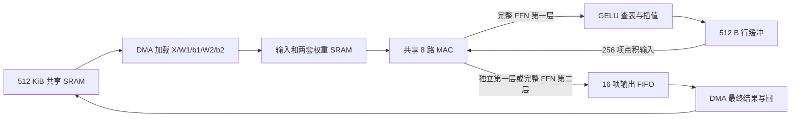

# 第五版：完整 FFN 与第一线性层独立模式

第五版在同一个 E203/DMA/计算引擎中支持两种运行模式。模式 0 保留本科必做的第一线性层，模式 1 完成 `Linear1 → GELU → Linear2`。完整 FFN 不包含残差、LayerNorm、注意力或分类头，不能称为完整 Transformer 编码器。

第四版基线固定为提交 `d501f0dee548969ee397622a42ced29ca8219239`，记录在 `performance-baseline-v4.json`。本地还保存了 `deliverables/undergraduate-v4-baseline.zip`、`deliverables/v4-source-baseline.zip` 和 `output/baseline-v4/`；当前交付包与这些历史文件分开。

## 两种任务的结果

| 指标 | 第四版第一线性层 | 第五版独立第一线性层 | 第五版完整 FFN |
| --- | ---: | ---: | ---: |
| 输入形状 | 99×64 | 99×64 | 99×64 |
| 输出形状 | 99×256 | 99×256 | 99×64 |
| 矩阵 MAC 次数 | 1,622,016 | 1,622,016 | 3,244,032 |
| 单任务整机周期 | 271,678 | **271,678** | **545,654** |
| 12 任务总周期 | 3,260,136 | 3,260,136 | 6,547,848 |
| 150 MHz 折算延迟 | 1.81119 ms | 1.81119 ms | **3.63769 ms** |
| 150 MHz 折算吞吐 | 552.12421 任务/s | 552.12421 任务/s | **274.89948 任务/s** |
| 输入/参数 DMA 读字数 | 11,616 | 11,616 | 19,872 |
| 结果 DMA 写字数 | 50,688 | 50,688 | 12,672 |

每条 SoC RTL/网表路径分别验证 12 个必做任务的 304,128 个输出，以及 12 个完整 FFN 任务的 76,032 个输出，均逐位一致；两种模式的综合前后周期分别相同。第五版没有降低必做模式吞吐。

完整 FFN 多做一次矩阵运算及 25,344 个 GELU，其任务定义和输出数量不同，不能把 274.90 与 552.12 任务/s 直接解释成性能退化，也不能将完整 FFN 吞吐作为本科必做评分的吞吐。150 MHz 尚未通过官方工艺 STA，表中毫秒和任务/s 都是目标频率下折算。

## 数据流与存储复用



完整 FFN 每行先计算 256 个第一层结果。每组八个累加结果依次经过一个 GELU 单元，写入两块 `16×128` 单端口 SRAM。该行 256 个中间元素全部就绪后，同一组八路 MAC 执行第二线性层的八组输出，每组点积长度为 256。第二层结果入队后进入下一行；中间行缓冲直接复用。

第一层点积长度仍为 64，第二层为 256；两层均以 40 位累加，不改变点积内部的 k 次序。两套权重在任务开始时完整加载，计算时不依赖 CPU 执行矩阵或 GELU 运算。

中间矩阵不访问共享 SRAM，实际中间共享 SRAM 事务数为 0。相对于将完整 `99×256` 的 int16 中间矩阵写回再读入，理论上免去 25,344 个 32 位事务；这是流量对照，不是另一个已实测实现的加速比。行缓冲仅 512 字节，完整中间矩阵则需要 50,688 字节。

## 数值格式与精度

必做 `model/format.json` 和整数模型保持冻结。选做格式另存于 `model/ffn-format.json`，模型为 `model/ffn_numeric.py`：

1. 第一线性层继续使用原来的 int16 输入/权重、int32 偏置、int40 累加。
2. 将第一层整数结果以最近偶数舍入转成 Q16，再计算 GELU。采用恒等式 `GELU(z)=max(z,0)-h(|z|)`，其中 `h(a)=a·Φ(-a)`。
3. 固定数学表在 `[0,8]` 上每 `1/32` 采样，共 257 项 Q16 修正量，进行线性插值；插值除法向负无穷取整，与 RTL 算术右移一致。绝对值达到 8 后使用正半轴恒等、负半轴零的尾部近似。表由 `generate_gelu.py` 生成可综合逻辑，不依赖样本或权重。
4. GELU 结果按冻结指数最近偶数舍入并饱和至 int16，进入第二线性层；输出仍为 int40 符号扩展成 int64。第二层 256 项合法乘积加 int32 偏置的绝对值小于 `2^39`，int40 足够。

中间量化范围来自 checkpoint、LayerNorm 解析界限和已量化第一层权重的最坏情况界限，不使用验证集拟合。第二层权重指数来自其绝对最大值。当前 12 层 GELU 中间指数均为 -9，输入右移 11 位、输出右移 7 位；第二层最终解码指数按层查表，不能统一误用第一层输出尺度。

| 数值检查 | 结果 |
| --- | ---: |
| 验证样本 | 与必做基线相同的 120 条样本 × 12 层 |
| 完整 FFN 最大逐层聚合 NRMSE | **0.139819%** |
| 所选 12 个硬件任务最大 NRMSE | **0.143616%** |
| 24 条训练样本 × 12 层最大聚合 NRMSE | **0.143927%** |
| 上述样本 GELU int16 饱和次数 | **0** |
| 第一线性层最大聚合 NRMSE | 仍为 **0.013202%** |

完整 FFN 的浮点参考直接调用指定 checkpoint 的原始 FFN（exact-erf GELU），不使用量化硬件模型替代浮点答案。3% 在这里是自行设定的选做工程检查门槛，不能当作指南对完整 FFN 单独规定的官方评分门槛。未评测完整网络分类准确率，也未执行官方 600 样本验收。

`model/validation-samples.json` 和 `training-samples.json` 固定样本文件名；导出按文件定位并核对划分，避免 unknown 子集和文件枚举顺序导致样本漂移。训练导出显式使用确定性采样。重新导出的必做向量清单哈希与第四版完全一致。

## KWT5 协议

DMA 基址仍为 `0x40000000`，ID 更新为 **`0x4b575435` / KWT5**；需使用配套固件。所有配置仅在空闲时允许写入，运行时修改模式、地址或数值配置会返回错误，当前任务继续。

| 偏移 | 含义 |
| --- | --- |
| `0x00` | 写 1 启动，写 2 中止并排空 |
| `0x04` | busy/done/error/aborted/config_error，位定义沿用前版 |
| `0x20/24/28/2c` | X/W1/b1/Y 地址 |
| `0x30/34` | W2/b2 地址，独立第一层模式忽略 |
| `0x38` | 0：独立第一线性层；1：完整 FFN；其他值启动时拒绝 |
| `0x3c` | GELU 输入右移位数在 `[4:0]`，输出右移在 `[12:8]`；完整 FFN 模式要求其余位为 0 |
| `0x40..78` | 原 15 项周期统计；MAC 活动数在完整模式中包含两层 |
| `0x7c` | 第二层 MAC 有效周期，完整任务 202,752 |
| `0x80` | GELU 处理周期，完整任务 25,344 |
| `0x84` | GELU int16 饱和计数，成功样本应核对是否为 0 |

X/W1/W2 都是每个 32 位字装两个相邻 int16，先出现的元素在低半字；两套权重均列优先，偏置为 int32。X/W1/b1 的地址和长度沿用第四版。W2 位于 `0xa0062000`、长度 32,768 字节；b2 位于 `0xa006a000`、长度 256 字节；Y 仍从 `0xa0030000` 起，独立第一层长 202,752 字节，完整 FFN 长 50,688 字节。

所有 DMA 缓冲区必须 4 字节对齐并完整落在共享数据 SRAM 范围内，输出不能与本模式使用的任何输入区重叠。两种模式都在最后一个成功写响应返回后才 done。错误/中止排空已发出的事务，清除核心有效状态；部分已写结果不回滚。

固件提供 `kwt_linear()` 和 `kwt_ffn()`。本地 mailbox 写 1 执行第一层、写 5 执行完整 FFN，完整模式的 GELU 配置放在 `0xa000f008`；完成仍回复 2。写 3 请求计时外快照，原 15 项位于 `0xa000f020..58`，新增三项位于 `0xa000f060/64/68`，发布标志仍在 `0xa000f05c`。`kwt_profile()` 的目标缓冲区须容纳 19 个 32 位字。

## 周期与资源

完整 FFN 每任务的互斥阶段为：外部加载/通知 **79,495**，DMA 加载 **26,567**，计算与最终写回 **438,800**，DMA 控制 **2**，CPU 配置及完成观察余量 **790**，相加为 **545,654**。

DMA 内部共 465,369 周期；两层 MAC 共有效 405,504 周期；GELU 共 25,344 周期；输出 FIFO 满等待为 0。首个输出时间戳 29,196，最后输出 465,364，最终写响应 465,369。诊断统计互相重叠，不能再次加到互斥阶段上。

| 资源 | 第四版 | 第五版两种模式共用的硬件 |
| --- | ---: | ---: |
| MAC 路数 | 8 | 8 |
| SRAM 容量 | 52 KiB | **85 KiB** |
| SRAM 宏数 | 20 | **40** |
| 计算核通用实例数 | 21,894 | 27,380 |
| 含计算核的 DMA 引擎实例数 | 26,611 | 33,786 |
| 本地 SoC 通用实例数 | 46,025 | 53,122 |

SRAM 组成为 2 个 `16×4096`、34 个 `16×1024`、4 个 `16×128` 单端口宏，共 87,040 字节。新增容量为第二层权重 32 KiB、偏置宏 512 字节和行缓冲 512 字节。各层级实例数不可重复相加；它们不是 mm²。即使只运行模式 0，最终综合网表中的新增模块也要计入提交设计面积，不能套用第四版面积。

正式 150 MHz 时序、2.25 mm² 面积预算、完整 SoC 功耗和能耗仍待官方工艺及平台。新增 GELU 的查表、插值与移位路径也需要正式 STA；当前没有新采集的完整 SoC 活动文件。

## 验证与复现

已完成两种模式的 RTL/综合网表逐位验证、15 项原统计及完整 FFN 新增三项统计检查；DMA 压力测试覆盖延迟最终响应、读写错误、地址/模式/移位配置错误、背压、中止、复位和恢复，并验证不复位切换 FFN→第一层→FFN。GELU 的 54,357 组向量覆盖分段边界、正负尾部、所有移位位数、舍入、饱和及随机值，在 RTL、综合网表和 Icarus 四态上均通过。

```powershell
.\design.ps1 export-ffn
.\design.ps1 gelu
.\design.ps1 ffn
.\design.ps1 soc
.\design.ps1 soc-ffn
.\design.ps1 fourstate
.\design.ps1 synth
.\design.ps1 synth-dma
.\design.ps1 synth-soc
python scripts/collect_results.py
python scripts/package_submission.py
```

从原模型完整复现使用 `.\design.ps1 all`。自定义完整 FFN 输入 NPZ 包含 `x,w,b,w2,b2` 和可选浮点 `y[99,64]`，可运行：

```powershell
.venv-model\Scripts\python.exe scripts/convert_ffn.py task.npz --layer 0 --output output/custom-ffn
.venv-model\Scripts\python.exe scripts/decode_output.py hardware-output.hex --layer 0 --ffn --output output/decoded-ffn.npy
```

`docs/ffn-validation.json` 单独记录选做精度、周期和日志哈希；`performance-comparison.json` 专门比较第四版与当前独立第一层模式，不混用两种任务。第四版源代码和交付包可直接恢复，不需要从第五版删除模块来重建历史结果。
